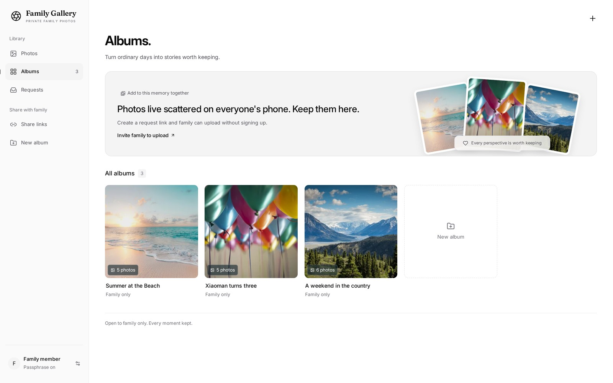
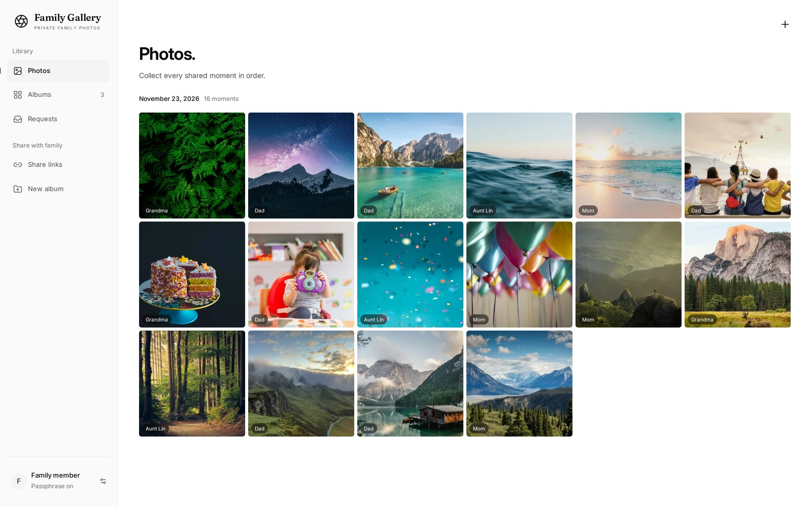
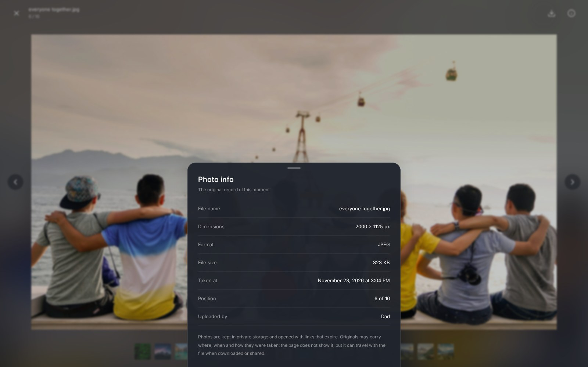
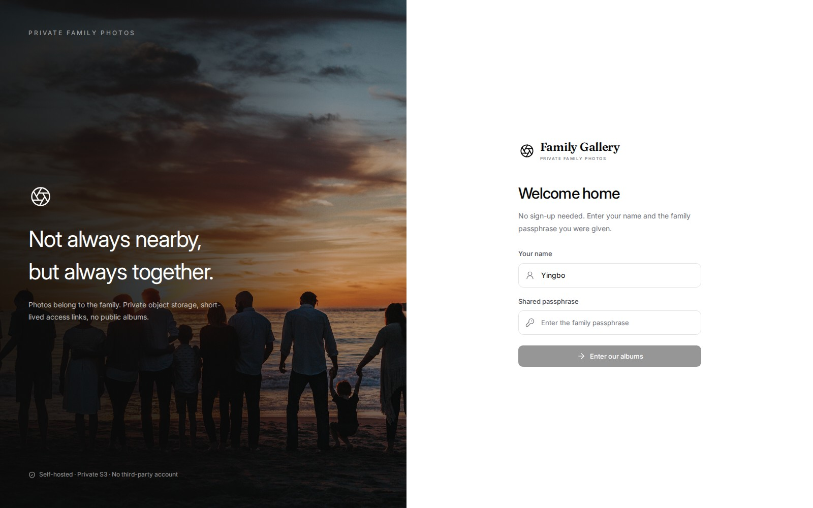
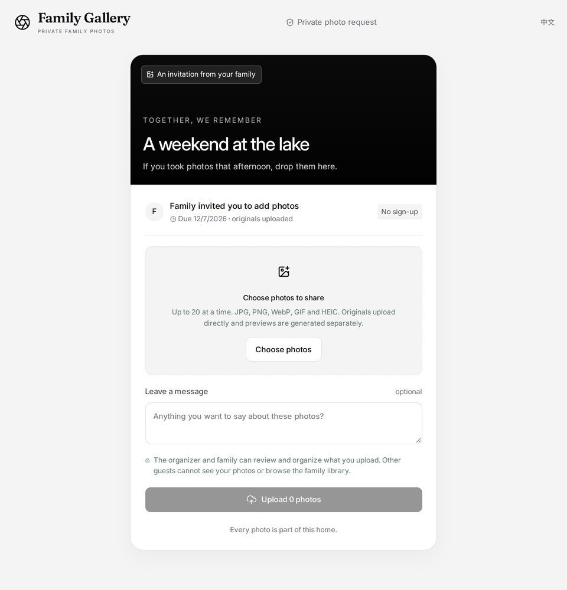

# Family Gallery · Self-hosted Family Photo Sharing

[](https://github.com/RainSunMe/family-gallery/actions/workflows/ci.yml)
[](./LICENSE)
[](https://go.dev)
[](https://react.dev)
[](./Dockerfile)

**A private family photo album you host yourself.** Built with Go, SQLite and any S3-compatible object storage.
Photos never pass through the application server: browsers upload directly to your own bucket, and the backend only issues short-lived signed URLs.

Not another Immich. There is no face recognition, no AI search, no mobile app and no account system — just one shared family library, invite links that let grandparents upload without signing up, and read-only links you can revoke.

<p align="center">
  
</p>

The whole interface is bilingual (English and Simplified Chinese). `DEFAULT_LANGUAGE` decides which one a visitor sees first; after signing in, the language can be changed in the settings dialog, and `?lang=zh` / `?lang=en` overrides it for a single visit.

> Keywords: self-hosted photo album · family photo sharing · photo collection · S3 · Garage · MinIO · Go · SQLite · React

> 中文说明见 [README.zh-CN.md](./README.zh-CN.md).

## Contents

- [Why use it](#why-use-it)
- [How it differs](#how-it-differs)
- [Screenshots](#screenshots)
- [Quick start](#quick-start)
- [Configuration](#configuration)
- [Object storage requirements](#object-storage-requirements)
- [HEIC photos](#heic-photos)
- [Capture time](#capture-time)
- [Architecture](#architecture)
- [Development and tests](#development-and-tests)
- [Current limitations](#current-limitations)
- [Contributing and security](#contributing-and-security)
- [License](#license)

## Why use it

| | |
| --- | --- |
| **Private storage** | Photos stay in your own bucket. The browser uploads and reads directly, so the app never relays a single byte. |
| **Photo requests** | One invite link lets family and friends upload without signing up, and each guest only sees their own submissions. |
| **Read-only sharing** | Album links and QR codes with an expiry you control, and a stop button for any moment. |
| **Cloud packaging** | The server builds bounded ZIP archives that can be downloaded in parts and are cleaned up after they expire. |
| **Small footprint** | A single container image ships the frontend and the API; one data volume is enough to run it. |
| **No account system** | Family and admin passphrases are separate, and sessions are stored as hashes. |

## How it differs

Roughly in order of how many people use them today. This is not a ranking — the
right tool depends on what the family actually needs.

| | Family Gallery | Immich | PhotoPrism | Ente Photos |
| --- | --- | --- | --- | --- |
| Primary goal | One shared family library | Full photo platform | AI-indexed library | Encrypted cloud |
| Database | SQLite, one file | PostgreSQL + Redis | SQLite or MySQL | Postgres + Redis |
| Media storage | Any S3-compatible bucket (required) | Local filesystem | Local filesystem | Local or S3 |
| Mobile background backup | No | Yes | No | Yes |
| Face / object recognition | No | Yes | Yes | No |
| End-to-end encryption | No | No | No | Yes |
| Guest upload without an account | Yes, scoped invite links | Shared links | No | No |
| Per-photo uploader label | Yes, stored with the photo | Via user accounts | Via user accounts | Via user accounts |
| Rough runtime footprint | One small container | Several containers, worker-heavy | Medium | Several containers |

Pick Family Gallery when the family is small, the NAS already has an S3 bucket,
and the hard part is getting photos *from* grandparents rather than organising
tens of thousands of files. Pick Immich if you want a Google Photos replacement
with phone backup and ML search. Pick Ente if end-to-end encryption is the
priority.

## Screenshots

**All photos** — every tile carries the name of whoever uploaded it.

<p align="center">
  
</p>

<p align="center">
  
  
</p>

<p align="center">
  <sub>Left: the viewer, with an expiry-scoped original and the uploader's name. Right: sign-in — one shared passphrase, plus the name that labels your uploads.</sub>
</p>

<p align="center">
  
</p>

<p align="center">
  <sub>The invite page: a grandparent opens one link, types a name, and adds photos. No account, no app.</sub>
</p>

## Quick start

Pull the published image, or build from source — either way you need a bucket and
two passphrases first.

```bash
docker pull ghcr.io/rainsunme/family-gallery:latest
```

```bash
git clone https://github.com/RainSunMe/family-gallery.git
cd family-gallery
cp .env.example .env      # replace every REPLACE_WITH_* placeholder
docker compose up -d      # add --build to compile from source instead
```

Then open `http://localhost:8080` and sign in with the family passphrase from `.env`.

> The image already contains the built frontend, so **do not** mount `web/dist` — it would shadow the image contents.
> In production, put the app behind an HTTPS reverse proxy and only expose its port.

### Without Compose

```bash
docker run -d --name gallery --env-file .env \
  -p 127.0.0.1:8080:8080 -v gallery-data:/app/data \
  ghcr.io/rainsunme/family-gallery:latest
```

Or build the image yourself:

```bash
docker build -t family-gallery .
docker run -d --name gallery --env-file .env \
  -p 127.0.0.1:8080:8080 -v gallery-data:/app/data \
  family-gallery
```

## Configuration

Everything is configured through environment variables. `APP_ENV` already defaults to `production`, which enforces passphrase strength and HTTPS.

### Required

| Variable | Description |
| --- | --- |
| `FAMILY_PASSWORD` | Family passphrase. `family` is rejected. |
| `ADMIN_PASSWORD` | Admin passphrase. Must differ from the family one; `admin` is rejected. |
| `SESSION_SECRET` | Random session key of at least 32 characters. |
| `S3_ENDPOINT` | Object storage endpoint used by the backend. |
| `S3_BUCKET` | Name of the private bucket. |
| `S3_ACCESS_KEY` / `S3_SECRET_KEY` | S3 credentials dedicated to this app. |

### Branding and appearance

The name, tagline and description shown in the UI can be changed without rebuilding the frontend:

| Variable | Default | Description |
| --- | --- | --- |
| `SITE_NAME` | `Family Gallery` | Shown in the sidebar, on the login page and in settings. |
| `SITE_TAGLINE` | `PRIVATE FAMILY PHOTOS` | Small caption under the name. |
| `SITE_DESCRIPTION` | `A self-hosted family photo album` | Shown at the bottom of the settings dialog. |

For a custom brand, just set the values in `.env`:

```dotenv
SITE_NAME=Orange Light
SITE_TAGLINE=ORANGE LIGHT FAMILY PHOTOS
SITE_DESCRIPTION=Our family album
```

### Language

| Variable | Default | Description |
| --- | --- | --- |
| `DEFAULT_LANGUAGE` | `en` | Language used when a visitor has no preference. Supported values: `en`, `zh`. |

API error messages follow the request language: the `lang` query parameter wins, then the `Accept-Language` header, then `DEFAULT_LANGUAGE`. The login page always uses `DEFAULT_LANGUAGE`, so there is no language switcher on the entry screen; after signing in, the language can be changed in the settings dialog (the choice is remembered in that browser), and `?lang=zh` / `?lang=en` overrides it for a single visit.

Note: a language picked in the settings dialog is stored per browser and always wins over `DEFAULT_LANGUAGE`.

### Runtime and access

| Variable | Default | Description |
| --- | --- | --- |
| `APP_ENV` | `production` | Set to `development` to disable production validation. |
| `APP_ADDR` | `:8080` | Listen address. |
| `APP_PUBLIC_URL` | `http://localhost:8080` | Public URL. Must be HTTPS in production. |
| `DATABASE_PATH` | `./data/gallery.db` | SQLite path. Inside the image it is `/app/data/gallery.db`. |
| `S3_PUBLIC_ENDPOINT` | falls back to `S3_ENDPOINT` | Browser-reachable S3 endpoint. Must be HTTPS in production. |
| `S3_REGION` | `garage` | Must match the object storage configuration. |
| `S3_USE_PATH_STYLE` | `true` | Required by most self-hosted S3 services. |
| `APP_ENV_FILE` | empty | Optional extra environment file. |

### Sessions and signatures

| Variable | Default |
| --- | --- |
| `FAMILY_SESSION_TTL` | `720h` |
| `ADMIN_SESSION_TTL` | `12h` |
| `SIGNED_READ_TTL` | `5m` |
| `SIGNED_UPLOAD_TTL` | `15m` |
| `COLLECTION_SESSION_TTL` | `168h` |

### Uploads, downloads and throttling

| Variable | Default | Description |
| --- | --- | --- |
| `MAX_UPLOAD_SIZE` | `209715200` | Per-file limit in bytes (200 MiB). |
| `MULTIPART_PART_SIZE` | `8388608` | Part size; S3 requires at least 5 MiB. |
| `DOWNLOAD_PART_SIZE` | `524288000` | Maximum size of one ZIP part (500 MiB). |
| `DOWNLOAD_RETENTION` | `24h` | How long download packages are kept. |
| `WORKER_INTERVAL` | `2s` | Poll interval of the packaging worker. |
| `LOGIN_MAX_ATTEMPTS` | `10` | Failed attempts before a block. |
| `LOGIN_BLOCK_DURATION` | `5m` | Block duration after too many failures. |

### Duplicates

| Variable | Default | Description |
| --- | --- | --- |
| `DEDUP_ENABLED` | `true` | Refuse a second copy of identical bytes in the same album. |
| `DEDUP_BACKFILL` | `false` | Hash photos uploaded before dedup existed, once at startup. |

The browser hashes every file with SHA-256 in a worker before uploading, so the
server can answer "this is already in this album" without transferring the
bytes. A match is never silently dropped: the upload dialog lists what it found
and lets you add the photo anyway. Comparison is per album and by exact file
contents — the same picture re-encoded, screenshotted or exported from HEIC is a
different file and uploads normally.

Turning `DEDUP_BACKFILL` on makes the first start read every existing original
back out of the bucket to hash it, which is why it is off by default. Photos
uploaded before dedup stays unhashed until you do, and the dialog says how many
of those an album holds.

See [docs/04-photo-dedup.md](./docs/04-photo-dedup.md) for the full design.

#### Trash

| Variable | Default | Description |
| --- | --- | --- |
| `TRASH_RETENTION` | `720h` | How long deleted photos wait before permanent deletion. `0` keeps them until an admin empties the trash. |

Deleting a photo moves it to the trash: it disappears from albums, counts, shares
and old download archives immediately, but its bytes stay in the bucket until the
retention window passes. A toast offers undo for eight seconds, and the trash page
can restore anything still in it. Restoring a photo whose album was also deleted
brings the album back too.

See [docs/05-trash.md](./docs/05-trash.md) for the full design.

## Object storage requirements

Any S3-compatible service works: **Garage, MinIO, SeaweedFS, Ceph RGW, AWS S3**, and others.

1. The bucket must be **private**; access only happens through short-lived presigned URLs.
2. Allow cross-origin `GET`, `PUT` and `HEAD` from the browser, and expose `ETag` (required for multipart uploads).
3. The host in `S3_PUBLIC_ENDPOINT` must match the one used for signing — you cannot sign against an internal address and then swap in the public domain.

After deploying, call this once as an admin to write an exact-origin CORS rule:

```bash
curl -X PUT https://photos.example.com/api/v1/storage/cors \
  -H 'Content-Type: application/json' \
  -H 'Origin: https://photos.example.com' \
  --cookie 'cg_session=<admin session>' \
  -d '{}'
```

## HEIC photos

iPhone shoots HEIC, and only Safari can decode it. Every other browser loads a
WebAssembly build of libheif on first use — a ~2 MB chunk that is fetched lazily,
so a browser that can already decode HEIC never downloads it.

Originals are never transcoded. The viewer shows the WebP preview for HEIC
because Chromium cannot render the original, and the download button still hands
back the untouched HEIC file.

## Capture time

Photos are sorted and grouped by **when they were taken**, read from the EXIF
`DateTimeOriginal` tag in the browser. EXIF stores a wall-clock time with no
offset, so it is interpreted in the uploader's own time zone and converted to UTC
before it is sent. Files without a usable timestamp fall back to the upload time.

Photos uploaded before this existed keep their old timestamps; nothing is
rewritten retroactively.

See [docs/07-exif-time.md](./docs/07-exif-time.md) for the parser and its limits.

The Content-Security-Policy includes `'wasm-unsafe-eval'`, which allows
WebAssembly to compile without permitting `eval()` of JavaScript.

See [docs/06-heic.md](./docs/06-heic.md) for the design and the tests.

## Architecture

```text
browser ── sign-in / metadata / signing ──> Go API ── SQLite (albums, requests, shares, jobs)
browser ── presigned PUT / GET ───────────> private S3 (originals / previews / thumbnails)
Go packaging worker ── GET / PUT ─────────> private S3 (ZIP parts)
```

| Path | Responsibility |
| --- | --- |
| `cmd/server` | Entry point, configuration loading, graceful shutdown |
| `internal/config` | All environment variables and production validation |
| `internal/database` | SQLite schema and migrations |
| `internal/httpapi` | Routing, auth, albums, requests, shares, downloads |
| `internal/i18n` | Message catalog and locale negotiation |
| `internal/storage` | Generic S3 adapter: signing, multipart, HEAD, Copy |
| `web/` | React + Vite + Tailwind frontend, served directly by Go |

## Development and tests

```bash
# Go: format, static analysis, unit tests
docker run --rm -v "$PWD":/src -w /src golang:1.27-alpine \
  sh -c 'gofmt -w cmd internal && go vet ./... && go test ./...'

# Frontend: type-check, production build and unit tests
docker run --rm -e CI=true -v "$PWD/web":/src -w /src node:22-alpine \
  sh -c 'corepack enable && corepack prepare pnpm@10.28.2 --activate && pnpm install --frozen-lockfile && pnpm build && pnpm test'
```

For local development, run a single-node Garage (or any S3-compatible service), set `APP_ENV=development`, and use plain HTTP.

Contributing with an AI agent? [AGENTS.md](./AGENTS.md) lists the constraints every
change has to respect. The full cycle from local checks to a published image is in
[docs/08-release-workflow.md](./docs/08-release-workflow.md).

## Current limitations

- JPEG, PNG, WebP, GIF and HEIC are supported. HEIC is decoded in the browser: Safari decodes it natively, everything else loads a WebAssembly build of libheif on first use. Video has no preview pipeline.
- The viewer shows the WebP preview for HEIC because browsers other than Safari cannot render the original. The original file is stored untouched and still downloads as HEIC.
- Duplicate detection compares exact bytes within one album. The same picture re-encoded or exported from HEIC counts as a different file, and the same file added to two albums is stored twice.
- Deleting moves photos to a trash that is emptied after `TRASH_RETENTION`. There is no per-photo history, so "who deleted this" is only as trustworthy as the name typed into that browser.
- Capture time comes from EXIF when the file has it. Photos uploaded before this feature, or files without usable EXIF, keep their upload time.
- Packaging runs inside the API process with a single worker loop. At larger scale, split it into a separate worker with durable leases.
- Both SQLite and the object store need their own backups, and restores should be rehearsed regularly.

## Contributing and security

Issues and focused pull requests are welcome — see [CONTRIBUTING.md](./CONTRIBUTING.md) for the local workflow and the few conventions this codebase cares about.

Please **do not** report security problems in a public issue. Use the [security policy](./SECURITY.md) instead; it also documents the threat model and an operator hardening checklist.

## License

[MIT](./LICENSE). Inter, Noto Sans SC and Fraunces under `web/public/fonts` are distributed under the SIL Open Font License, which ships alongside the fonts.

The login background is an Unsplash photograph used under the Unsplash License; its source is recorded in `web/public/media/CREDITS.md`.
