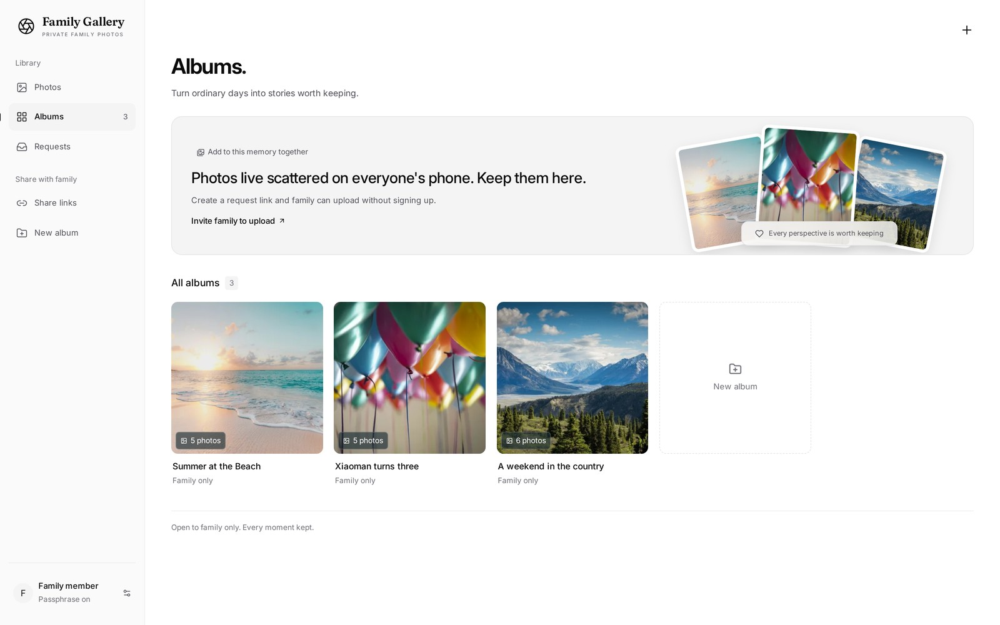
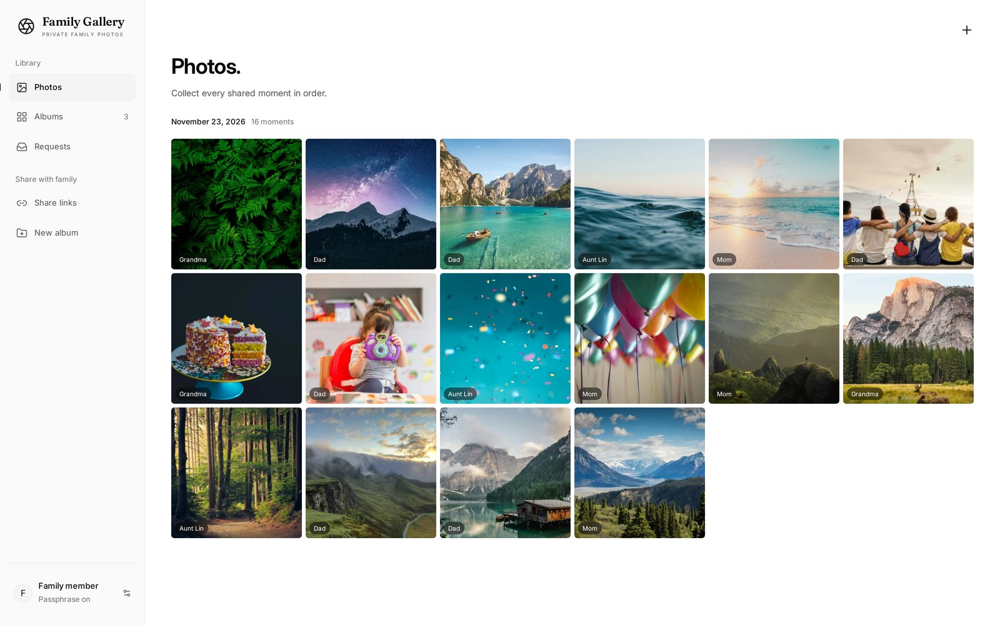
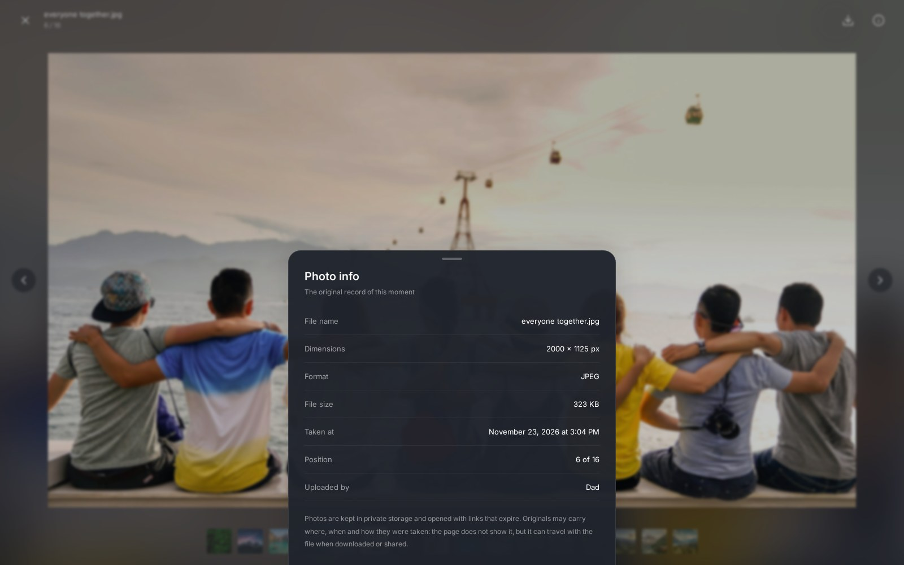
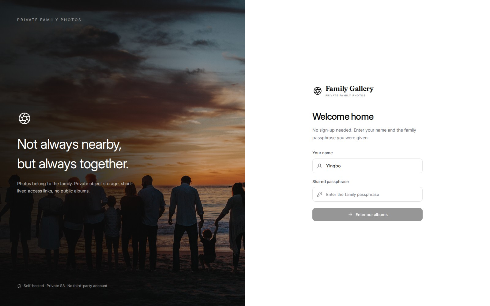
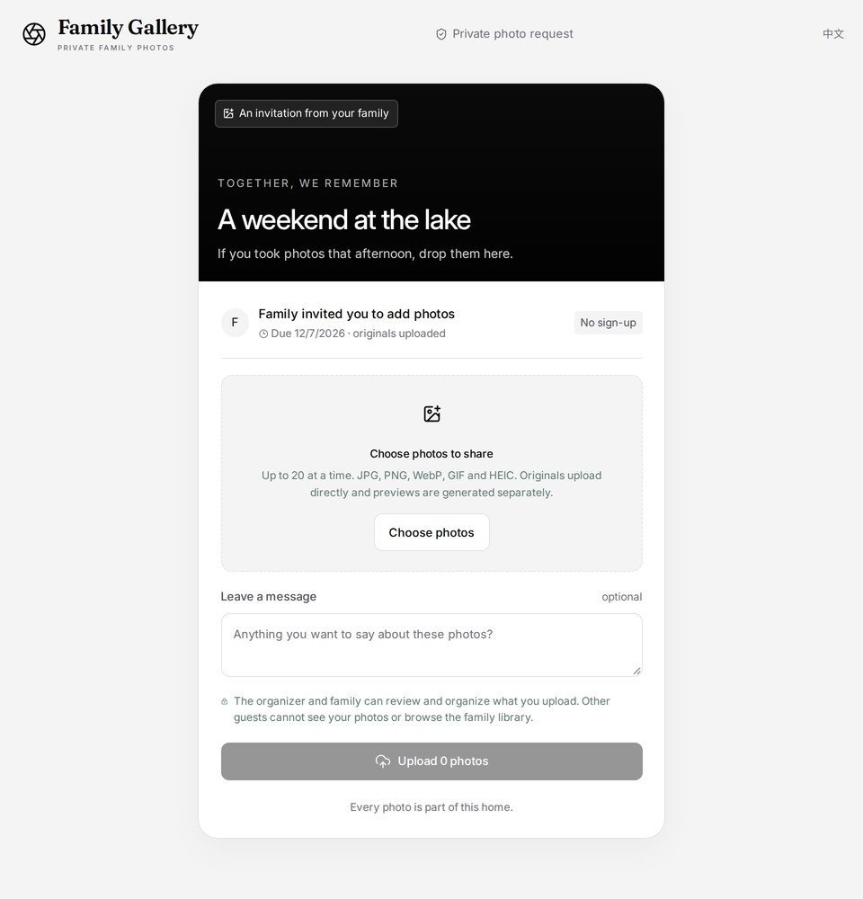

# Family Gallery · 自托管家庭共享相册

[](https://github.com/RainSunMe/family-gallery/actions/workflows/ci.yml)
[](./LICENSE)
[](https://go.dev)
[](https://react.dev)
[](./Dockerfile)

> 这是 [README.md](./README.md) 的中文版本。界面为完整双语（简体中文 / English），`DEFAULT_LANGUAGE` 决定首次打开时的语言；登录后可在设置页切换，`?lang=zh` / `?lang=en` 可临时覆盖。

一个**自托管的家庭共享相册**，面向家人之间的照片收集、整理与只读分享。
照片直传你自己拥有的私有 S3，应用只负责身份、权限、元数据与签名。没有第三方账号，也没有公开图库。

它不是又一个 Immich：没有人脸识别、没有 AI 检索、没有手机 App、也没有账号体系 —— 只有一个共享的家庭图库、让长辈不用注册就能上传的邀请链接，以及随时可撤销的只读链接。

<p align="center">
  
</p>

> 关键词 / Keywords: self-hosted photo album · family photo sharing · photo collection · S3 · Garage · MinIO · Go · SQLite · React

## 目录

- [为什么用它](#为什么用它)
- [和同类项目的区别](#和同类项目的区别)
- [界面截图](#界面截图)
- [快速开始](#快速开始)
- [配置](#配置)
- [对象存储要求](#对象存储要求)
- [架构](#架构)
- [开发与测试](#开发与测试)
- [当前边界](#当前边界)
- [参与贡献与安全问题](#参与贡献与安全问题)
- [许可](#许可)

## 为什么用它

| | |
| --- | --- |
| **私有存储** | 照片放在你自己的 Bucket，浏览器直传直读，应用不中转字节 |
| **照片收集** | 一条邀请链接，亲友无需注册即可上传，只能看到自己的提交 |
| **只读分享** | 可设有效期、可随时撤销的相册链接与二维码 |
| **云端打包** | 服务端生成有界 ZIP、可分卷下载，过期自动清理 |
| **轻量部署** | 单个容器镜像 = 前端 + API，一个数据卷即可运行 |
| **无需账号体系** | 家庭口令与管理口令分离，会话以哈希形式存储 |

## 和同类项目的区别

大致按当前使用人数排序，不是排名 —— 合适的工具取决于家里真正缺什么。

| | Family Gallery | Immich | PhotoPrism | Ente Photos |
| --- | --- | --- | --- | --- |
| 主要定位 | 一个共享的家庭图库 | 完整的照片平台 | AI 索引图库 | 端到端加密云 |
| 数据库 | SQLite 单文件 | PostgreSQL + Redis | SQLite 或 MySQL | Postgres + Redis |
| 媒体存储 | 任意 S3 兼容 Bucket（必需） | 本地文件系统 | 本地文件系统 | 本地或 S3 |
| 手机后台备份 | 无 | 有 | 无 | 有 |
| 人脸 / 物体识别 | 无 | 有 | 有 | 无 |
| 端到端加密 | 无 | 无 | 无 | 有 |
| 访客免注册上传 | 有，邀请链接限定范围 | 分享链接 | 无 | 无 |
| 单张照片的上传者标记 | 有，随照片存储 | 依赖用户账户 | 依赖用户账户 | 依赖用户账户 |
| 运行时占用 | 一个小容器 | 多容器，worker 较重 | 中等 | 多容器 |

什么时候选它：家里人不多、NAS 上已经有 S3 Bucket、真正的难点是**让长辈把照片交出来**，而不是整理几万张文件。
想要替代 Google Photos（手机备份 + ML 检索）选 Immich；把端到端加密放在第一位选 Ente。

## 界面截图

**全部照片** —— 每张照片都标着上传者。

<p align="center">
  
</p>

<p align="center">
  
  
</p>

<p align="center">
  <sub>左：查看器，短效原图链接与上传者名字。右：登录页 —— 一条共享口令，加上标注上传者的名字。</sub>
</p>

<p align="center">
  
</p>

<p align="center">
  <sub>邀请页：长辈打开一条链接，填个名字就能上传。没有账号，也不用装 App。</sub>
</p>

## 快速开始

先拉取已发布的镜像，或者从源码构建 —— 两种情况都需要先准备好 Bucket 和两个口令。

```bash
docker pull ghcr.io/rainsunme/family-gallery:latest
```

```bash
git clone https://github.com/RainSunMe/family-gallery.git
cd family-gallery
cp .env.example .env      # 填写所有 REPLACE_WITH_* 值
docker compose up -d      # 加 --build 则改为从源码编译
```

打开 `http://localhost:8080` 并使用 `.env` 中配置的家庭口令登录。

> 镜像内已经包含构建好的前端，**不要**挂载 `web/dist`，否则会覆盖镜像内容。
> 生产环境请放在 HTTPS 反向代理之后，只暴露应用端口。

### 不用 Compose

```bash
docker run -d --name gallery --env-file .env \
  -p 127.0.0.1:8080:8080 -v gallery-data:/app/data \
  ghcr.io/rainsunme/family-gallery:latest
```

也可以自己构建镜像：

```bash
docker build -t family-gallery .
docker run -d --name gallery --env-file .env \
  -p 127.0.0.1:8080:8080 -v gallery-data:/app/data \
  family-gallery
```

## 配置

全部配置通过环境变量提供。`APP_ENV` 默认就是 `production`，会强制校验口令强度与 HTTPS。

### 必填

| 变量 | 说明 |
| --- | --- |
| `FAMILY_PASSWORD` | 家庭共享口令，不能是 `family` |
| `ADMIN_PASSWORD` | 管理口令，必须与家庭口令不同，不能是 `admin` |
| `SESSION_SECRET` | 至少 32 字符的随机会话密钥 |
| `S3_ENDPOINT` | 后端访问对象存储的地址 |
| `S3_BUCKET` | 私有 Bucket 名称 |
| `S3_ACCESS_KEY` / `S3_SECRET_KEY` | 应用专用 S3 凭据 |

### 品牌与外观

界面上展示的名称、副标题和描述都可以改，无需重新构建前端：

| 变量 | 默认值 | 说明 |
| --- | --- | --- |
| `SITE_NAME` | `Family Gallery` | 侧栏、登录页、设置页显示的名称 |
| `SITE_TAGLINE` | `PRIVATE FAMILY PHOTOS` | 名称下方的小号英文副标题 |
| `SITE_DESCRIPTION` | `自托管的家庭共享相册` | 设置页底部的描述 |

例如想叫「橙光」，只需在 `.env` 中写：

```dotenv
SITE_NAME=橙光
SITE_TAGLINE=TUANGGUANG FAMILY PHOTOS
SITE_DESCRIPTION=家庭相册
```

### 界面语言

| 变量 | 默认值 | 说明 |
| --- | --- | --- |
| `DEFAULT_LANGUAGE` | `en` | 界面默认语言，可选 `en`、`zh` |

登录页直接使用 `DEFAULT_LANGUAGE`，因此入口没有语言切换按钮；登录后可在设置页切换语言，选择会记在当前浏览器里。`?lang=zh` / `?lang=en` 可临时覆盖。接口错误信息同理：`lang` 参数优先，其次 `Accept-Language`，最后 `DEFAULT_LANGUAGE`。

### 运行与访问

| 变量 | 默认值 | 说明 |
| --- | --- | --- |
| `APP_ENV` | `production` | 设为 `development` 关闭生产校验 |
| `APP_ADDR` | `:8080` | 监听地址 |
| `APP_PUBLIC_URL` | `http://localhost:8080` | 对外访问地址，生产必须 HTTPS |
| `DATABASE_PATH` | `./data/gallery.db` | SQLite 路径，镜像内为 `/app/data/gallery.db` |
| `S3_PUBLIC_ENDPOINT` | 回退到 `S3_ENDPOINT` | 浏览器可访问的 S3 地址，生产必须 HTTPS |
| `S3_REGION` | `garage` | 与对象存储配置一致 |
| `S3_USE_PATH_STYLE` | `true` | 多数自托管 S3 需要开启 |
| `APP_ENV_FILE` | 空 | 可选的补充环境变量文件 |

### 会话与签名

| 变量 | 默认值 |
| --- | --- |
| `FAMILY_SESSION_TTL` | `720h` |
| `ADMIN_SESSION_TTL` | `12h` |
| `SIGNED_READ_TTL` | `5m` |
| `SIGNED_UPLOAD_TTL` | `15m` |
| `COLLECTION_SESSION_TTL` | `168h` |

### 上传、下载与限流

| 变量 | 默认值 | 说明 |
| --- | --- | --- |
| `MAX_UPLOAD_SIZE` | `209715200` | 单文件上限（字节，200 MiB） |
| `MULTIPART_PART_SIZE` | `8388608` | 分片大小，S3 最小 5 MiB |
| `DOWNLOAD_PART_SIZE` | `524288000` | ZIP 分卷上限（500 MiB） |
| `DOWNLOAD_RETENTION` | `24h` | 下载包保留时间 |
| `WORKER_INTERVAL` | `2s` | 打包任务轮询间隔 |
| `LOGIN_MAX_ATTEMPTS` | `10` | 连续失败上限 |
| `LOGIN_BLOCK_DURATION` | `5m` | 失败封禁时长 |

## 对象存储要求

任何兼容 S3 的服务都可以：**Garage、MinIO、SeaweedFS、Ceph RGW、AWS S3** 等。

1. Bucket 必须**私有**，访问只能通过短效预签名链接。
2. 允许浏览器跨域 `GET`、`PUT`、`HEAD`，并暴露 `ETag`（分片上传必需）。
3. `S3_PUBLIC_ENDPOINT` 的主机必须与签名时使用的一致，不能用内网地址签名后替换公网域名。

部署完成后，以管理员身份调用一次即可写入精确来源的 CORS 规则：

```bash
curl -X PUT https://photos.example.com/api/v1/storage/cors \
  -H 'Content-Type: application/json' \
  -H 'Origin: https://photos.example.com' \
  --cookie 'cg_session=<管理会话>' \
  -d '{}'
```

## 架构

```text
浏览器 ── 登录 / 元数据 / 签名 ──> Go API ── SQLite（相册、收集、分享、任务）
浏览器 ── 预签名 PUT / GET ──────> 私有 S3（原图 / 预览图 / 缩略图）
Go 打包任务 ── GET / PUT ────────> 私有 S3（ZIP 分卷）
```

| 目录 | 职责 |
| --- | --- |
| `cmd/server` | 入口、配置加载、优雅退出 |
| `internal/config` | 全部环境变量与生产校验 |
| `internal/database` | SQLite 表结构与迁移 |
| `internal/httpapi` | 路由、鉴权、相册、收集、分享、下载 |
| `internal/storage` | 通用 S3 适配：预签名、分片、HEAD、Copy |
| `web/` | React + Vite + Tailwind 前端，由 Go 直接托管 |

## 开发与测试

```bash
# Go：格式化、静态检查、单元测试
docker run --rm -v "$PWD":/src -w /src golang:1.27-alpine \
  sh -c 'gofmt -w cmd internal && go vet ./... && go test ./...'

# 前端：类型检查与生产构建
docker run --rm -e CI=true -v "$PWD/web":/src -w /src node:22-alpine \
  sh -c 'corepack enable && corepack prepare pnpm@10.28.2 --activate && pnpm install --frozen-lockfile && pnpm build'
```

本地联调可以自行启动一个单节点 Garage（或任意 S3 兼容服务），把 `APP_ENV` 设为 `development` 并使用 HTTP 地址。

## 当前边界

- 浏览器端完整支持 JPG、PNG、WebP、GIF；HEIC/HEIF 与视频暂无预览或转码链路。
- 删除与回收站 UI 尚未开放。
- 打包任务运行在 API 进程内，单 worker 循环；大规模使用时可拆分为独立 worker 并加入持久租约。
- SQLite 与对象存储都需要自行备份，并定期演练恢复。

## 参与贡献与安全问题

欢迎提 issue 和范围集中的 PR，本地开发流程与代码约定见 [CONTRIBUTING.md](./CONTRIBUTING.md)。

**请勿**在公开 issue 中报告安全问题，改用 [安全策略](./SECURITY.md)；其中也记录了威胁模型与运维加固清单。

## 许可

[MIT](./LICENSE)。`web/public/fonts` 中的 Inter 与 Noto Sans SC 以 SIL Open Font License 分发，许可证随字体一同提供。

登录页背景图是 Unsplash 照片，按 Unsplash License 使用，来源记录在 `web/public/media/CREDITS.md`。
