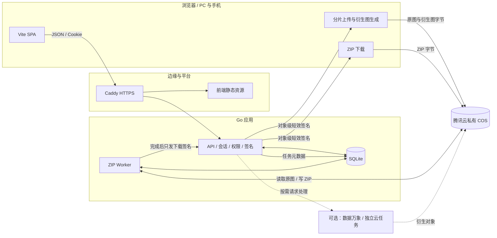
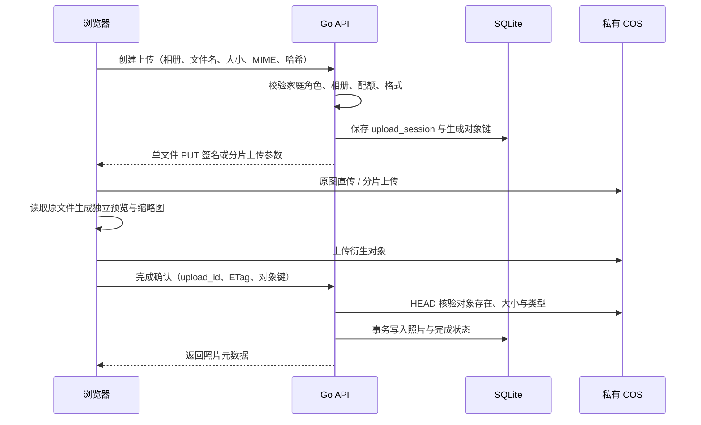
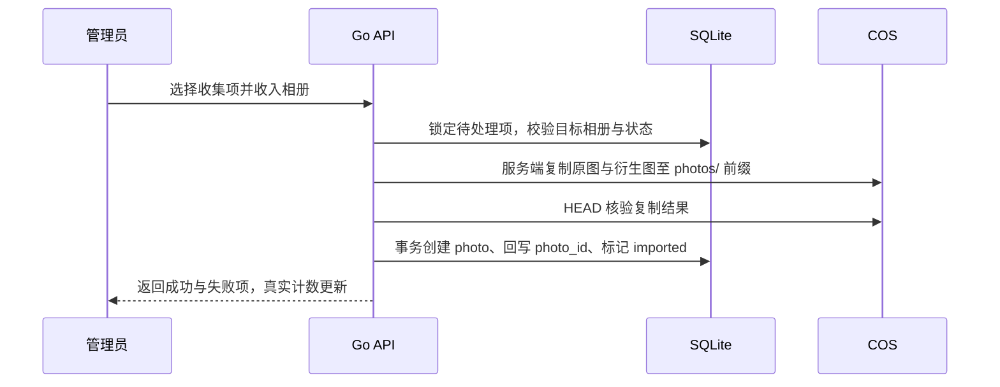

# 澄光 · 家庭共享相册 技术方案

- **版本**：v1.0
- **日期**：2026-11-22
- **对应产品文档**：[`01-product-requirements.md`](./01-product-requirements.md)
- **对应设计稿**：`final-design/`（整理目录时已删除）
- **现状约束**：迁移期云资源与服务器现状记录（整理目录时已删除）

> **归档说明**：本文是迁移前的技术方案，属历史档案。文中提到的 `app/`、`final-design/`、
> 迁移交接记录均已在仓库整理时删除，当前实现见仓库根目录的 `README.md`。
>
> 本文是开发方案，不是部署完成记录。COS、CAM、证书与服务器现状以迁移期实测记录为准；本文不读取或包含任何密钥。

## 1. 技术目标与选型

### 1.1 硬约束

1. 服务器公网带宽约 4 Mbps，原图、预览图、缩略图、视频与 ZIP 不得经应用服务器中转。
2. 私有 COS，应用只处理鉴权、元数据、签名、任务协调和少量控制请求。
3. 无个人账号体系，共享口令、管理口令、只读分享与收集邀请必须分别鉴权。
4. 保留原图，预览衍生图不得覆盖原图。
5. 大相册下载不能依赖手机浏览器读取全部文件并在内存中打包。

### 1.2 推荐技术栈

| 层级 | 选择 | 理由 |
| --- | --- | --- |
| 前端 | Vite + TypeScript + React + Tailwind CSS | 构建快、组件与路由生态清晰，可准确复用设计 Token，无需 SSR |
| UI 状态 | 轻量响应式 store + TanStack Query | 服务端缓存与上传/选择等本地状态分离，避免全局 store 失控 |
| 路由 | TanStack Router | 类型化路由、独立访客页面与权限守卫清晰 |
| 后端 | Go 1.24+（以实际稳定版本为准） | 启动快、资源占用低、单二进制部署、并发与标准库适合轻量 API |
| HTTP | chi | 路由与中间件简单，不引入重型 Web 框架 |
| 数据库 | SQLite + `modernc.org/sqlite` | 无独立数据库进程，适合单家庭元数据；纯 Go 驱动简化镜像 |
| COS | 腾讯云官方 Go COS SDK / 官方签名机制 | 生产环境不维护临时手写签名算法 |
| 下载任务 | 同机独立 worker 进程 + SQLite 持久任务队列 | 小规模部署无需 Kafka/Redis；崩溃可恢复，数据仍不经应用服务器出口 |
| 部署 | Docker Compose + Caddy | 自动 HTTPS、静态资源缓存、简单回滚；先盘点现有反代再实施 |
| 测试 | Go test、Vitest、Playwright | 单元、API、浏览器和移动端关键路径覆盖 |

### 1.3 为什么选择 Go，而不是 Rust

Rust 可以提供更高的极限性能与内存安全保证，但本项目主要瓶颈是 COS 网络、浏览器上传、SQLite 查询与云端 ZIP I/O，而不是 JSON 鉴权计算。图片字节不经过 API 进程后，Go 与 Rust 在用户体验上的差距通常不显著。

当前优先 Go 的理由：

- 更小的团队认知与维护成本，适合快速交付和长期自托管。
- 腾讯云 COS 官方 Go SDK 是直接的实现路径，减少兼容验证工作。
- 单二进制、小镜像、成熟并发模型，足以覆盖单家庭负载。
- 便于将 API 与 ZIP worker 共享领域代码但独立运行。

如果未来需要自研高吞吐图像转码服务，可单独评估 Rust；不让理论性能影响当前控制面的简洁性。ZIP 属于 CPU/I/O 任务，由独立 worker 限量执行，不能与 API 争抢整机资源。

### 1.4 不推荐的首期方案

- 不用 Next.js SSR：这是私有交互应用，没有 SEO 或内容服务端渲染需求。
- 不引入微服务、Kubernetes、Kafka、Elasticsearch：单家庭规模不收益。
- 不使用 imgproxy/Thumbor 经 4 Mbps 服务器输出图片。
- 不把长期 SecretKey 放前端，不通过公开桶绕过鉴权。
- 不把 COS 预签名 URL 当永久访问凭证或存入数据库长期使用。
- 不默认启用数据万象；开通前单独评估格式、预览链路与成本。

## 2. 总体架构



### 2.1 进程边界

- **Web/API**：无状态 HTTP 进程，可横向扩展，但 SQLite 写入仍受单写约束。
- **Worker**：单独容器/进程，同一任务使用原子租约，默认并发 1，限制 CPU、内存、临时磁盘与网络。
- **Scheduler**：低频率清理、回收站到期、下载包过期、上传对账；可由 worker 内的定时循环执行。
- **SQLite**：单文件元数据，WAL 模式；不能用多个容器共同写入 NFS/SMB 上的 SQLite 文件。
- **COS**：唯一图片与下载包数据源；应用数据库只保存对象键和元数据，不保存图片字节。

### 2.2 部署拓扑

首期同机运行 Caddy、前端静态资源、Go API、Go worker。 worker 读取 COS 消耗的是服务器入向流量与 CPU，输出 ZIP 到 COS 使用服务器出口；因此批量打包仍须限速与排队。完成后的 ZIP 下载不占应用服务器出口。

> “所有图片不走应用服务器”不等于服务端 worker 从不读取 COS。ZIP 云端打包需要 worker 读取原图并写回 COS；它不能经同步 HTTP 请求在 4 Mbps 出口实时转发给浏览器。

## 3. 前端设计

### 3.1 建议目录

```text
apps/web/
  src/
    app/                 # 启动、Provider、路由、全局错误边界
    routes/              # family / album / collect / share / guest
    features/
      auth/
      albums/
      photos/
      uploads/
      collections/
      shares/
      downloads/
      settings/
    components/ui/        # Button、Dialog、Toast、Skeleton 等无业务组件
    lib/                  # API client、COS client、格式、哈希、工具
    workers/              # 可选：图片衍生、哈希计算
    styles/               # Tailwind 入口与全局样式
    test/
```

### 3.2 从设计稿迁移而非重写体验

- 将 `styles.css` 与 `readability.css` 中的颜色、字号、间距、圆角、阴影转为 Tailwind `@theme` Token。
- 保留桌面侧栏、手机纯图标玻璃胶囊底栏、Active 无小点、网格密度和访客独立页。
- 参考 `app.js` 的交互意图，但用类型化组件和路由替代全局可变状态与字符串事件分发。
- 不直接复制演示数据；所有计数、分享状态、同步状态、贡献者均来自 API。
- 保持 `360 / 390 / 768 / 1440px` 无横向溢出、主要文字对比度 ≥ 4.5:1。
- 桌面正文与主要操作 `13–14px`、辅助信息 `11–12px`；手机主要按钮 `42–44px`，表单输入 `16px`。
- 二维码由服务端基于邀请 URL 生成 SVG 并设置不可缓存响应，或由前端纯本地库对当前邀请 URL 编码；不调用第三方二维码图片服务，不泄露邀请 token。
- 深色模式采用 class 策略；本地只保存外观偏好，不保存口令或会话。

### 3.3 状态职责

| 状态 | 存放位置 | 说明 |
| --- | --- | --- |
| 相册、照片、分享、收集元数据 | TanStack Query | 按游标缓存、失效重取、请求去重 |
| 登录角色、会话过期 | Auth Provider | 不保存口令，只保存服务端返回的角色与过期时间 |
| 选择模式与选中 ID | 当前页面 store | 切路由清空，跨页选择明确限制 |
| 上传队列 | Upload Store + IndexedDB 元数据 | 保存待传文件句柄能力按浏览器渐进增强，不能承诺任意恢复 |
| 下载任务 | Query 轮询 + 页面任务条 | 页面刷新后按任务 ID 恢复状态 |
| 外观 | localStorage | 仅 `light / dark / system` 非敏感值 |

### 3.4 路由与权限

```text
/login
/photos
/albums
/albums/:albumId
/collections
/collections/:collectionId
/shares
/settings
/guest/collect/:token       # 收集参与者，不挂载家庭导航
/guest/share/:token         # 只读访客，不挂载家庭导航
```

- 家庭路由校验家庭会话；管理组件再按角色显示，但服务端仍逐接口鉴权。
- 收集和分享 token 可出现在 URL，因为它们是授予受限能力的邀请凭证；不得记录进分析平台或错误日志。
- 失效链接进入统一失效页，不将访客重定向到家庭口令页后暴露相册信息。
- 前端不生成 COS 签名，不持有 SecretKey。

### 3.5 图片与上传体验

- 可见区域优先加载 `thumb`；查看器加载 `preview`；只有用户明确下载时获取原图。
- 使用 `IntersectionObserver`、图片解码异步化与分页，避免大相册长列表占满内存。
- 按屏幕宽度请求合理尺寸，禁止列表直接加载 1400px 或原图。
- 上传并发建议原图 2、衍生图 2；按网络失败与内存压力调整，分片建议 8 MiB。
- 原图在上传前不可被 canvas 压缩覆盖；衍生图另建对象。
- HEIC 通过 Web Worker 尝试转换；失败则明确提示该文件不可预览，允许取消或按支持的策略上传原文件。首发是否接收原 HEIC 由兼容测试决定。
- 视频首期只承诺已验证的编码；不默认把大视频转为 canvas 图片。

## 4. 后端设计

### 4.1 Go 模块

```text
cmd/
  server/               # HTTP API
  worker/               # ZIP 与清理任务
internal/
  config/               # 安全环境配置
  httpapi/              # handler、middleware、错误协议
  auth/                 # 口令哈希、会话、令牌、限流
  albums/
  photos/
  collections/
  shares/
  uploads/
  downloads/
  storage/              # COS 接口、签名、对象核验
  database/             # migration、事务、查询
  tasks/                # 租约、重试、超时、恢复
  observability/        # 日志、指标、审计
migrations/
```

- 业务层依赖 `ObjectStorage` 接口，单测用 fake，不依赖真实 COS。
- 处理函数不拼接任意对象键；对象键由服务端按 UUID 与范围生成。
- 事务负责相册、照片、收集导入和任务状态的一致性。
- `context.Context` 贯穿请求、数据库、COS 与任务；超时和取消不能仅停留在 UI。
- 统一错误码与可重试信息，不把 SQL、COS 密钥、签名参数或内部路径返回给客户端。

### 4.2 会话与口令

- 口令以 Argon2id 哈希保存于服务端配置/初始化元数据中；部署时通过安全方式写入，不保存明文。
- 口令校验采用常量时间比较，登录失败按 IP、入口类型与设备匿名指纹限速。
- 会话 token 使用至少 256 bit 随机数，Cookie 仅存原始 token，数据库保存 SHA-256 哈希。
- 会话包含 `family` 或 `admin` 角色；管理员修改口令后可撤销旧会话。
- Cookie：`HttpOnly; Secure; SameSite=Lax; Path=/`。跨站写操作校验 Origin，不能只靠 SameSite。
- 不返回可长期使用的访问 token 给 localStorage。

### 4.3 分享与收集令牌

- 原始令牌使用 `crypto/rand` 生成至少 32 字节随机数，URL-safe Base64。
- 数据库只保存令牌哈希，创建时向用户展示一次原始链接。
- 权限范围固定：`share:<share_id>` 或 `collect:<collection_id>`，不可由请求参数扩大。
- 分享 Cookie 与收集 Cookie 分别设置 Path 和独立名称，避免一个受限会话访问另一个入口。
- 收集会话只读本人提交的元数据；分享会话只读目标相册元数据。
- 链接撤销、过期、角色不符、资源不符都拒绝签发 COS URL。

## 5. 数据模型

### 5.1 核心表

| 表 | 关键字段 | 约束与用途 |
| --- | --- | --- |
| `albums` | `id`, `name`, `description`, `cover_photo_id`, `created_at`, `updated_at`, `deleted_at` | 软删除；计数由可靠统计维护 |
| `photos` | `id`, `album_id`, `original_key`, `preview_key`, `thumb_key`, `mime`, `size`, `width`, `height`, `taken_at`, `created_at`, `sha256`, `deleted_at` | 对象键唯一；同文件哈希用于对账，不默认跨相册去重 |
| `sessions` | `id`, `token_hash`, `role`, `expires_at`, `created_at`, `last_seen_at` | 家庭会话 |
| `shares` | `id`, `album_id`, `token_hash`, `expires_at`, `revoked_at`, `created_by`, `view_count` | 单相册只读授权 |
| `collections` | `id`, `name`, `description`, `album_id`, `token_hash`, `status`, `expires_at`, `batch_limit`, `allow_message`, `created_at` | 进行中/结束与目标相册 |
| `collection_sessions` | `id`, `collection_id`, `token_hash`, `display_name`, `expires_at`, `revoked_at` | 参与者受限会话 |
| `submissions` | `id`, `collection_id`, `session_id`, `display_name`, `message`, `status`, `created_at` | 一组提交及来源 |
| `submission_items` | `id`, `submission_id`, `original_key`, `preview_key`, `thumb_key`, `photo_id`, `status`, `imported_at` | 待整理、已收入、失败、已撤回；`photo_id` 唯一防重复导入 |
| `upload_sessions` | `id`, `scope_type`, `scope_id`, `object_key`, `cos_upload_id`, `expected_size`, `status`, `expires_at` | 分片上传状态与过期清理 |
| `download_jobs` | `id`, `scope_type`, `scope_id`, `requested_by`, `mode`, `status`, `progress`, `total_bytes`, `expires_at`, `error_code` | 持久任务与权限快照 |
| `download_packages` | `id`, `job_id`, `part_no`, `object_key`, `size`, `file_count`, `created_at` | ZIP 分卷及下载对象 |
| `audit_events` | `id`, `actor_type`, `actor_id`, `action`, `resource_type`, `resource_id`, `created_at`, `result` | 不含敏感 token/URL 的审计 |

### 5.2 关键索引与约束

- `photos(album_id, deleted_at, taken_at DESC, id DESC)` 支撑稳定游标分页。
- `photos(original_key) UNIQUE`、`submission_items(original_key) UNIQUE`。
- `submission_items(photo_id) UNIQUE WHERE photo_id IS NOT NULL`，避免重复收入。
- `collections(status, expires_at)`、`shares(album_id, revoked_at, expires_at)`。
- `download_jobs(status, created_at)` 支撑任务领取；不得用“先查再改”的非原子方式抢任务。
- 相册照片数不直接信任客户端提交；通过事务计数变更或定期对账计算。

### 5.3 COS 对象键

```text
photos/
  originals/{photo_uuid}/{safe_uuid_filename}
  previews/{photo_uuid}.webp
  thumbs/{photo_uuid}.webp
collections/
  {collection_uuid}/originals/{submission_item_uuid}/{safe_uuid_filename}
  {collection_uuid}/previews/{submission_item_uuid}.webp
  {collection_uuid}/thumbs/{submission_item_uuid}.webp
exports/
  {job_uuid}/part-001.zip
trash/
  {original_or_collection_prefix...} # 仅在需要服务端对象回收策略时移动
```

- 不使用原始文件名作为唯一路径；文件名只存元数据。
- 收集对象在导入前与家庭相册对象隔离，收集签名不能访问 `photos/`。
- 导入相册可采用 COS 服务端 Copy Object 至 `photos/originals/...`，随后核验并更新数据库；Copy 失败不能标记成功。
- 桶私有，CORS 仅允许实际 Web Origin、必要方法和 Header，暴露 ETag，不使用 `*` 搭配凭据。
- 预览响应需正确设置 `Content-Type`、缓存与可预览的 `Content-Disposition`。

## 6. 核心流程

### 6.1 家庭上传



- 小文件可用单 PUT；大文件与移动端使用分片上传。
- 完成接口必须幂等，同一 `upload_session` 重试不重复创建照片。
- 客户端哈希用于重复提示，不能替代服务端 HEAD 与完整性验证。
- 原图上传成功但衍生图失败：可保留原图并标记“待生成预览”，进入补偿队列；不能伪装完整成功。
- 超过有效期的未完成分片上传由清理任务 Abort，并清理数据库状态。

### 6.2 收集上传

1. 收集参与者用邀请 token 建立受限会话并设置称呼。
2. 服务端校验收集状态、有效期、会话、单批数量、累计容量与限流。
3. 只签发 `collections/{collection_id}/...` 下新对象的上传权限。
4. 完成后创建 `submission` 与 `submission_items`，默认 `pending`。
5. 参与者只能获取自己的提交元数据与签名读取 URL，不能查询他人提交。
6. 收集结束后不再创建上传会话；既有短期 URL 到期自然失效。
7. 收集公开提交页不提供原图永久地址，参与者撤回只影响其未收入项。

### 6.3 收入相册



- 幂等键：`collection_id + submission_item_ids + actor_request_id`。
- 大收集导入使用异步任务，防止长请求超时；页面显示逐项进度。
- 已收入项再次请求返回当前状态，不重复复制或增加相册计数。
- 收集对象可保留至收集到期清理；若立即删除，必须确保复制与数据库事务均成功，并有对账恢复策略。

### 6.4 浏览与签名读取

1. 客户端请求家庭照片、分享相册或自己的收集项。
2. API 校验角色与资源范围，仅返回数据库中可见的对象键元数据。
3. 需要展示时按 `thumb` / `preview` / `original` 请求短效读取 URL。
4. 读取签名仅允许指定对象，不授予列桶或其他前缀权限。
5. 默认签名有效期建议 5 分钟；URL 不写日志，浏览器缓存策略按隐私需求设置。
6. 对象域名必须使用签发时的 Host；不能把 COS 默认域名的签名 URL 直接替换成自定义域名。

可进一步优化为按权限范围批量签发只读临时凭据，但必须验证 SDK、权限边界和过期行为；首版优先对象级短效签名，避免过早复杂化。

### 6.5 ZIP 云端下载任务

1. 客户端提交相册或选中照片；服务端重新计算权限内的文件快照，不信任客户端大小。
2. 创建持久 `download_job`，状态 `queued`，前端显示排队进度。
3. Worker 原子领取任务，限制单任务内存、临时文件和并发。
4. 按固定顺序从 COS 下载原图，边读取边写入 ZIP，避免同时加载整个相册。
5. 500 MB 模式按实际累计原图大小与 ZIP 边界拆包，文件名冲突自动去重。
6. ZIP 写入 `exports/{job_id}/part-n.zip`，数据库记录每包文件数与真实大小。
7. 完成后签发短期 COS 下载 URL，前端可直接跳转或触发浏览器下载。
8. 取消任务时停止后续文件并清理临时对象；失败按可重试错误退避，超限后标记失败。
9. 到期后删除导出对象与任务包记录，历史审计仅保留非敏感元数据。

**资源建议**：worker 默认并发 1、限制 CPU 与内存、ZIP 使用 Store 而非重复压缩 JPEG；具体阈值需按服务器配置压测。图片上传不受影响，但批量导出会消耗 COS 读取与上传流量，需要队列与速率限制。

### 6.6 删除与恢复

- 家庭普通成员无删除权限；管理员删除先写 `deleted_at`。
- 数据库软删除后从网格与分享读取范围立即排除。
- 回收站恢复必须校验目标相册仍存在且原对象可用。
- 到期清理通过异步任务删除 COS 对象，再完成数据库清理；失败可重试。
- 需要在 CAM 中精确增加 `photos/` 和 `collections/` 范围内删除权限，不能授桶级全权。

## 7. API 契约摘要

统一前缀 `/api/v1`，响应使用一致错误结构：

```json
{
  "error": {
    "code": "COLLECTION_EXPIRED",
    "message": "这次照片收集已结束。",
    "retryable": false,
    "request_id": "..."
  }
}
```

| 模块 | 方法与路径 | 权限与说明 |
| --- | --- | --- |
| 登录 | `POST /auth/login`、`POST /auth/logout`、`GET /auth/session` | 家庭或管理口令，限速 |
| 相册 | `GET/POST /albums`、`GET/PATCH /albums/{id}` | 家庭可读建；修改仅管理 |
| 照片 | `GET /albums/{id}/photos?cursor=&limit=`、`GET /photos` | 游标分页，不包含对象永久 URL |
| 读取 | `POST /media/sign-read` | 按角色与资源范围签发指定衍生对象 |
| 上传 | `POST /uploads`、`POST /uploads/{id}/parts/sign`、`POST /uploads/{id}/complete`、`DELETE /uploads/{id}` | 家庭成员；收集走独立路径 |
| 收集管理 | `GET/POST /collections`、`GET /collections/{id}`、`POST /collections/{id}/close` | 家庭可读建；结束仅管理 |
| 收集导入 | `POST /collections/{id}/imports` | 管理权限，幂等异步任务 |
| 收集访客 | `POST /guest/collections/{token}/session`、`POST /guest/collections/uploads`、`GET /guest/collections/submissions` | 仅当前收集及当前会话 |
| 分享管理 | `GET/POST /shares`、`DELETE /shares/{id}` | 家庭可读建；撤销本人分享，管理员可撤销任意分享 |
| 分享访客 | `GET /guest/shares/{token}/album`、`GET /guest/shares/{token}/photos` | 单相册只读，不能列其他相册 |
| 下载 | `POST /downloads`、`GET /downloads/{id}`、`POST /downloads/{id}/cancel`、`POST /downloads/{id}/sign` | 重新鉴权，检查任务所有者与范围 |

### 7.1 分页与读取 URL

```json
{
  "items": [
    {
      "id": "photo_uuid",
      "name": "IMG_2041.JPG",
      "mime": "image/jpeg",
      "width": 4032,
      "height": 3024,
      "taken_at": "2026-10-05T14:32:00+08:00",
      "media": {
        "thumb": {"object_id": "...", "expires_at": "..."}
      }
    }
  ],
  "next_cursor": "opaque_cursor"
}
```

实际 URL 可由独立短效读取接口返回，并设置与签名有效期一致的客户端缓存；不返回长期对象地址。游标为不透明签名值，防止客户端伪造页码和排序条件。

## 8. 安全方案

### 8.1 授权矩阵

| 能力 | 家庭会话 | 管理会话 | 分享会话 | 收集会话 |
| --- | --- | --- | --- | --- |
| 列家庭相册 | 是 | 是 | 否 | 否 |
| 创建相册/家庭上传 | 是 | 是 | 否 | 否 |
| 重命名/删除/恢复 | 否 | 是 | 否 | 否 |
| 创建只读分享/照片收集 | 是 | 是 | 否 | 否 |
| 撤销自己创建的分享 | 是 | 是 | 否 | 否 |
| 撤销任意分享/结束收集 | 否 | 是 | 否 | 否 |
| 读取指定分享相册 | 是 | 是 | 仅指定相册 | 否 |
| 上传至收集 | 否 | 否 | 否 | 仅有效收集 |
| 查看收集全部贡献者 | 是 | 是 | 否 | 否 |
| 查看自己的收集提交 | 不适用 | 不适用 | 否 | 仅当前会话 |

### 8.2 Web 与 API

- Caddy 强制 HTTPS，配置现代 TLS；先修复对象域名证书并验证签名 Host。
- 配置 CSP、`X-Content-Type-Options: nosniff`、合理 `Referrer-Policy` 与 frame 限制。
- CORS 不使用通配符；只允许确定的平台 Origin。分享和收集页面仍使用同源 API。
- 写接口校验 Origin；JSON 请求体与文件元数据限制长度，防止异常输入。
- 所有 HTML 文本使用框架默认转义；文件名与留言不通过 `innerHTML` 输出。
- 使用不可预测 UUID 与安全随机 token，禁止路径遍历、SQL 拼接和任意 COS Key 输入。
- 日志记录 request ID、角色类别、状态码和耗时，不记录 Cookie、口令、token、签名 query。

### 8.3 COS 与凭据

- 生产 SecretId/SecretKey 仅由 Go 服务从权限为 `600` 的专用环境文件或秘密管理器读取。
- 不使用工作区中混合旧服务配置的 `.env`，不将其加载为生产配置。
- 现有 CAM 策略需复核：桶列表权限覆盖全桶元数据，如桶只服务本应用可接受，否则独立桶或缩小范围。
- 上传、读取、删除和导出对象按最小前缀分配权限。
- 若采用 STS，临时凭据仍需按角色和对象前缀限制，不能把“临时”当成“安全范围任意”。
- 预签名 URL 短期有效，HTTPS 证书匹配后才能投入浏览器使用。

## 9. 性能与可靠性

### 9.1 性能措施

- 首屏只请求相册元数据和可见缩略图，预览与缩略图缓存分离。
- 游标分页稳定处理新增照片，避免 offset 在大相册中越来越慢。
- SQLite 开启 WAL、合理 `busy_timeout`、事务批量化；避免长事务中访问 COS。
- COS 签名可短缓存相同只读对象，但撤销后只等短签名自然过期，不能永久缓存。
- 上传限制并发，分片失败指数退避；重试必须幂等。
- ZIP worker 使用流式 IO 和有界队列，避免任务耗尽 API 的 CPU/内存。
- API 与 worker 设置独立资源限制、请求超时、COS 超时与健康检查。

### 9.2 一致性与对账

数据库与 COS 无法形成单一事务，因此采用状态机与对账：

- `upload_pending → uploaded → verifying → ready / failed / aborted`。
- `submission pending → importing → imported / failed`。
- `download queued → running → succeeded / failed / cancelled / expired`。
- 定期扫描长时间未完成上传、缺失对象、孤立衍生图、成功复制但未提交元数据等异常。
- 对账默认只报告；自动修复或删除需可证明安全，不能清理仍在处理的任务。
- 任务租约包含过期时间与心跳，worker 崩溃后其他任务可接管。

### 9.3 备份与清理

- SQLite 使用事务一致的备份机制，不直接复制正在写入的数据库文件。
- 数据库每日备份、定期恢复演练；COS 可另行评估版本控制与跨区域备份成本。
- 过期分片上传、回收站、下载包、失效会话分别由清理任务处理。
- 备份不包含明文 token、口令或完整签名 URL；密钥备份通过独立安全渠道管理。

## 10. 可观测性与运维

### 10.1 指标

- API：请求量、P50/P95/P99、4xx/5xx、鉴权失败、限流、SQLite 锁等待。
- 上传：签名次数、完成率、失败格式、分片重试、过期未完成数量。
- COS：签名失败、HEAD/Copy 失败、对象缺失；避免在日志输出签名 URL。
- 任务：队列长度、运行时长、ZIP 成功率、包大小、清理数量、worker 资源占用。
- 业务：有效分享、收集中数量、导入成功率，不采集广告画像。

### 10.2 部署前门槛

1. 盘点现有服务器磁盘、内存、容器、端口、反代和备份，不覆盖已有服务。
2. 确认平台域名、对象域名、证书与 DNS，区分 API/静态站与 COS Host。
3. 使用专用权限为 `600` 的生产环境文件，不读取或复制混合旧配置。
4. 复核 CAM 密钥并清理未使用旧密钥，执行真实小对象上传/读取测试。
5. 配置精确 CORS，验证匿名读取拒绝、签名过期、预签名上传和分片恢复。
6. 在批准的资源限制下测试云端 ZIP，再启用公开入口。
7. 配置错误告警、磁盘/流量告警、备份和回滚步骤。

## 11. 测试与验收

### 11.1 后端

- 权限矩阵逐接口测试：家庭、管理、分享、收集、匿名与过期会话。
- 口令与会话测试：哈希、限速、过期、撤销、Cookie 属性、Origin 校验。
- 上传状态机、幂等完成、重复文件名、缺失对象、超限、Abort 清理。
- 收集隔离、参与者本人范围、结束收集、重复导入、撤销未导入项。
- 分享撤销与到期、资源替换攻击、其他相册 ID 猜测。
- SQLite 迁移、事务回滚、游标分页、worker 租约与崩溃恢复。

### 11.2 前端

- 组件：上传队列、选择栏、收集表单、分享状态、任务进度与错误状态。
- 路由：访客不加载家庭导航，家庭会话过期回登录，只读页无上传请求。
- 上传 mock：选择、分片、失败重试、取消、完成确认、HEIC 失败路径。
- 下载 mock：排队、轮询、完成、撤销、过期、分卷下载。
- 可访问性：弹窗焦点、键盘、图标 aria-label、减少动画、对比度。

### 11.3 端到端与真实 COS

- PC Chrome、Android Chrome、iOS Safari、微信内置浏览器基本路径。
- 浏览器 Network 验证图片、原图上传和 ZIP 下载直接指向 COS 或经鉴权的对象 CDN。
- 测试慢网、断网、后台切换、手机存储不足、页面刷新和任务跨页面恢复。
- 验证私有对象匿名访问失败、撤销分享、结束收集、签名过期后不能继续读取。
- 验证 10,000 文件相册分页与选择；ZIP 大任务不在浏览器内打包。
- 设计回归：390px 与 1440px，保留玻璃纯图标底栏、文字层级与无横向溢出。

## 12. 实施拆分

### 阶段 0：技术验证

- Go API 健康检查、SQLite migration、生产配置加载。
- COS 真实小对象上传、读取、分片、CORS、HTTPS Host 验证。
- 验证 JPEG 浏览器衍生图与 HEIC 策略。
- 验证单任务云端 ZIP 与 COS 下载，测量资源消耗。

### 阶段 1：家庭基础图库

- Vite/Tailwind 设计 Token 与应用壳、口令会话。
- 相册、照片分页、上传队列、COS 直读与单文件下载。
- 错误状态、加载状态、手机布局、基础测试。

### 阶段 2：分享与下载

- 只读链接、权限会话、分享管理。
- 持久下载队列、worker、分卷、清理、任务进度。
- 回收站与管理权限完善。

### 阶段 3：照片收集

- 邀请、二维码、受限会话、独立前缀上传、留言与提交记录。
- 贡献者、待整理、异步导入、结束/过期、越权测试。

### 阶段 4：上线

- 性能压测、备份恢复、监控告警、格式矩阵、兼容测试与回滚。
- 完成真实设备与 Network 验收后才切换到正式域名。

## 13. 默认配置建议

以下为可调整的工程初值，不是已验证的生产限制：

| 配置 | 初值 | 备注 |
| --- | --- | --- |
| 读取签名有效期 | 5 分钟 | 不写日志，撤销依赖短签名过期 |
| 上传签名有效期 | 15 分钟 | 分片会话可另设更长有效期 |
| 家庭会话 | 30 天滚动，最长 90 天 | 口令修改后可撤销 |
| 管理会话 | 12 小时 | 敏感操作可再次验证 |
| 单文件上限 | 200 MiB | 视频策略另行配置 |
| 家庭单批 | 100 个文件 | UI 分批并行，原图保留 |
| 收集单批 | 20 个文件 | 与创建表单一并限制 |
| 分片大小 | 8 MiB | 弱网测试后调整 |
| 上传并发 | 原图 2 + 衍生图 2 | 移动端动态降级 |
| ZIP 拆包阈值 | 500 MiB | 以实际文件与 ZIP 边界为准 |
| ZIP 保留 | 24 小时 | 自动清理对象 |
| 回收站保留 | 30 天 | 到期异步删除 |
| Worker 并发 | 1 | 压测后调整，不与 API 争满资源 |

## 14. 待决策清单

1. **ZIP 资源**：同机限量 worker 是否满足规模；若导出频繁，改用云函数/独立云任务。
2. **HEIC/视频**：首发兼容范围、转换失败处理与是否启用数据万象。
3. **下载权限**：只读分享是否允许原图，或只允许去除敏感 EXIF 的预览。
4. **域名**：平台域名、COS 对象域名、证书、CDN 与缓存策略。
5. **规模**：最大相册、文件大小、视频比例、备份保留与流量预算。
6. **预览补偿**：客户端衍生图失败后采用数据万象还是独立云任务，不能回退到 4 Mbps 图片代理。
