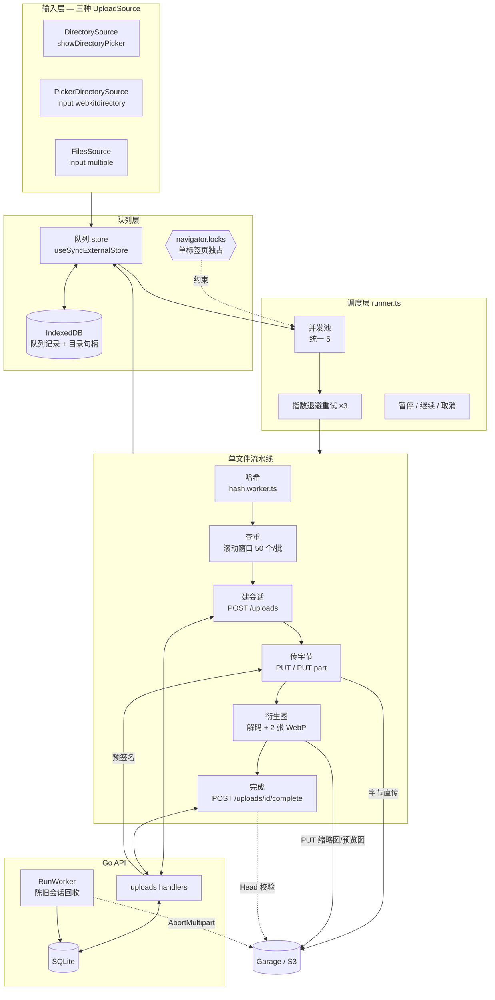
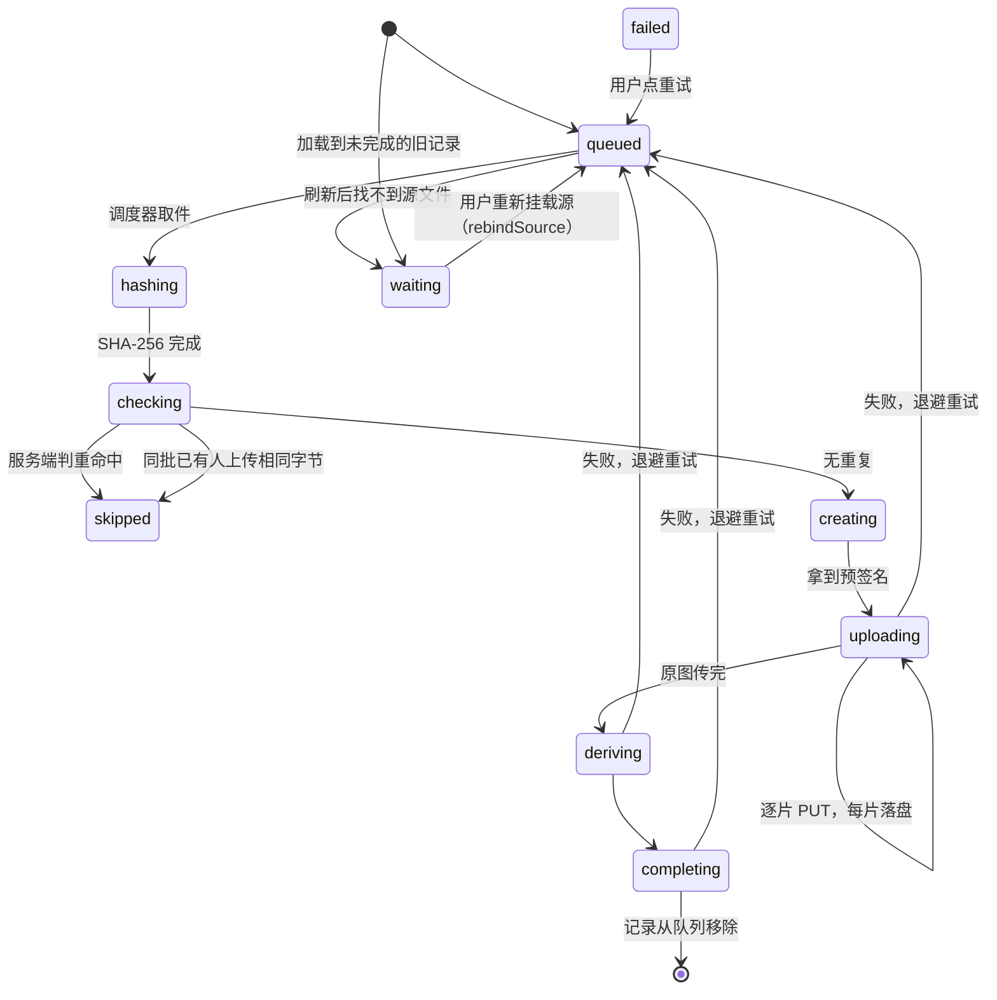
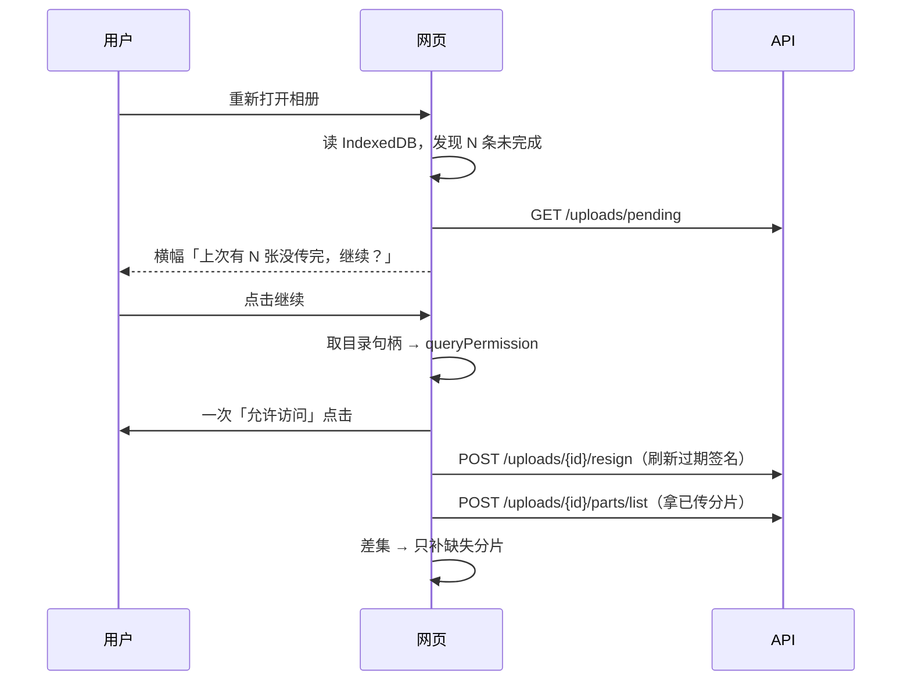

# 批量上传队列（Upload Queue）

- **状态**：P1-a（后端）、P1-b（队列基础设施）、P1-c（队列页 UI）、P1-d（PWA）
  已实现并验证；P1-e（1000 张实测）待做
- **影响范围**：`web/src/lib/upload.ts`、`web/src/lib/queue/*`、
  `web/src/components/UploadDialog.tsx`、`internal/httpapi/uploads.go`、
  `internal/storage/storage.go`、`internal/database/database.go`、
  `internal/httpapi/downloads.go`（worker）
- **不改动的底线**：图片字节仍由浏览器直传 S3，应用服务器不解码、不中转、不重编码原图

### 实现进度

| 期 | 内容 | 状态 |
| --- | --- | --- |
| P1-a | schema + `ListParts` + pending/resign/parts-list + `complete` 自愈 + 回收器 | ✅ 已实现 |
| P1-b | `queue/{types,db,source,matcher,store,runner}` + `upload.ts` 拆成可复用步骤 | ✅ 已实现 |
| P1-c | 队列页 `/uploads` + 添加来源对话框 + 侧栏/顶栏入口 | ✅ 已实现 |
| P1-d | PWA（`sw.js` / manifest / 独立静态路由） | ✅ 已实现 |
| P1-e | 真实 1000 张实测 + 文档定稿 | 待做 |

P1-a 的实测记录见 §16，P1-b 见 §17，P1-c 见 §18。

> **顺带修掉的既有 bug（重要）**：`listPhotos` 的分页游标取自"多取的那一行"，
> 导致**每翻一页静默丢一张照片**。250 张分 6 页丢 4 张，用户看到的就是"传上去了但
> 相册里看不到"。已修复并加了回归测试 `TestPhotoPaginationLosesNoRow`。

---

## 1. 为什么必须重做

### 1.1 已知硬缺陷：超过 200 张直接失败

`UploadDialog.tsx` 在上传前把**整批**哈希一次性提交：

```ts
result = await checkDuplicates(albumID, [...byHash.keys()]);
```

而 `internal/httpapi/dedup.go` 有硬上限：

```go
const maxDedupHashes = 200
if len(wanted) > maxDedupHashes {
    writeError(w, http.StatusBadRequest, "TOO_MANY_HASHES", ...)
}
```

所以**不是"一次只能传一百张"，而是 200 张以上必然报错**。用户感知到的"一百张上限"来自
iOS 文件选择器，掩盖了这个 bug。

### 1.2 四个真实瓶颈

| # | 位置 | 问题 | 后果 |
| --- | --- | --- | --- |
| 1 | `UploadDialog.tsx` → `hashFiles(files)` | 上传前串行预处理**整批**（2 个 worker） | 1000 张要等全部哈希完才开始传 |
| 2 | `UploadDialog.tsx` 的 `for ... await uploadPhoto` | 严格串行；每张内部还要解码 + 生成 2 张 WebP | HEIC 单张 200–500 ms，1000 张解码就 5 分钟以上 |
| 3 | `upload.ts` 的 `pendingParts`（模块级 `Map`） | 分片 ETag 只在内存 | **刷新即丢**，`complete` 永远无法完成，只能整文件重传 |
| 4 | `respondUpload` 一次性签发 `thumb_url` / `preview_url` | `SIGNED_UPLOAD_TTL` 默认 15 分钟 | 超过 15 分钟或隔天恢复，签名已过期 |

### 1.3 后端已具备的一半能力

| 已有 | 位置 |
| --- | --- |
| 超过 `MULTIPART_PART_SIZE`（默认 8 MiB）自动转 multipart | `uploads.go` `respondUpload` |
| 逐分片预签名 | `storage.go` `SignPart` |
| 上传会话表（`actor_hash` / `status` / `content_hash` / `taken_at`） | `database.go` `upload_sessions` |
| 重复检测（含并发竞态处理） | `dedup.go` + `completeFamilyUpload` |
| 内置后台 worker 循环 | `downloads.go` `RunWorker` |

缺少的只有五件：`ListParts`、pending 列表、重新签发、`complete` 服务端自愈、陈旧会话回收。

---

## 2. 目标与非目标

### 2.1 目标

| 项目 | 验收标准 |
| --- | --- |
| 单次批量 | 桌面 1000 张（按 2000 张设计）；移动端同桌面，无客户端上限 |
| 中断恢复 | 刷新、关标签页、断网后重开：**已传分片不重传** |
| 启动延迟 | 第一张开始上传的时间与批次总量**无关** |
| 吞吐 | 桌面与移动统一文件级并发 5 + 单文件分片并发 3 |
| 重复检测 | 跨批次增量检测，不阻塞上传启动 |
| 依赖 | 不新增后端依赖（无 Redis / Kafka / 新容器）；SQLite + Garage 不变 |
| 兼容 | 旧标签页与新 API 并存，不回退现有行为 |
| 免重复授权 | 桌面 Chrome 安装为 PWA 后，目录权限跨会话保持 |

### 2.2 非目标

- **不做真正的"后台上传"**：浏览器关闭标签页即停止，这是平台限制。能做到的是"进度不丢 +
  回来一键续传"。真正的无人值守需要 CLI，本期不做（见 §11）。
- **不做服务端中转**：任何"由服务器接收字节再转存"的方案（含 tusd 的 S3 store）都违反
  本项目核心不变量，明确否决。
- **不做离线浏览**：service worker 采用**零缓存**策略（见 §10）。

---

## 3. 全景架构



**核心转变**：从「整批预处理 → 串行上传」改为「**每文件独立流水线 + 全局并发池 + 状态实时落盘**」。
第 1 张在传的时候，第 900 张才刚开始哈希，前置时间从线性变成常数。

---

## 4. 输入层：三种源，能力不同，流水线相同

### 4.1 抽象接口

实际实现（`web/src/lib/queue/source.ts`）。`list()` 是 `Promise` 而不是异步迭代器：
目录枚举本身已经 `await`，而一次性拿到列表才能做指纹匹配和"勾选子集"的渲染。

```ts
export type SourceKind = 'directory' | 'picker-directory' | 'files';

export type SourceEntry = {
  name: string;
  size: number;
  mtime: number;
  /** 目录源用句柄定位；文件源直接用引用 */
  handle?: FileSystemFileHandle;
  file?: File;
};

export interface UploadSource {
  readonly kind: SourceKind;
  /** 句柄能否跨会话恢复 */
  readonly resumable: boolean;
  list(): Promise<SourceEntry[]>;
  open(entry: SourceEntry): Promise<File>;
  /** 仅目录源：恢复时重新申请权限 */
  reauthorize?(): Promise<boolean>;
}
```

三种实现由 `src/lib/queue/source.ts` 提供：`DirectorySource`（指纹 + 句柄，可恢复）、
`PickedDirectorySource`（`webkitdirectory`，需重选）、`FileListSource`（`multiple`）。
指纹统一用 `entryKey(name, size, mtime)`。

### 4.2 浏览器支持矩阵（2026-11 核对）

| 能力 | Chrome 桌面 | Safari 桌面 | Firefox | Chrome Android | iOS Safari |
| --- | --- | --- | --- | --- | --- |
| `showDirectoryPicker`（句柄可持久化） | ✅ 86+ | ❌ | ❌ | ✅ 132+ | ❌ |
| `<input webkitdirectory>`（不可持久化） | ✅ | ✅ 11.1+ | ✅ 50+ | ✅ | ✅ 18.4+ |
| `<input multiple>` | ✅ | ✅ | ✅ | ✅ | ✅ |

选源顺序：`showDirectoryPicker` → `webkitdirectory` → `multiple`。

> **微信内置浏览器**：家人通过微信打开时只能用 `multiple`（系统相册选择器），
> `webkitdirectory` 基本不可用。这条需要单独手测。

### 4.3 "授权整个文件夹，只传其中一部分"

这正是目录句柄的设计意图：**权限粒度是文件夹，选择粒度是文件**。

```ts
const dir = await showDirectoryPicker({ id: 'gallery-import', startIn: 'pictures' });
await idb.put('sourceHandle', dir);          // 句柄可结构化克隆进 IndexedDB

for await (const entry of dir.values()) {    // 只列元数据
  if (entry.kind !== 'file') continue;
  if (!isSupportedName(entry.name)) continue;
  entries.push(entry);
}
// UI 渲染成网格，用户勾选任意子集；上传时才 entry.getFile()
```

要点：

1. **恢复不需要重选文件**，只需一次点击：
   ```ts
   if (await dir.queryPermission({ mode: 'read' }) !== 'granted') {
     await dir.requestPermission({ mode: 'read' });   // 需用户手势
   }
   ```
2. **权限寿命取决于是否安装为 PWA**：普通标签页关闭即失效，安装后可跨会话保持 —— 这是
   §10 加 PWA 的唯一实质理由。
3. **大目录必须惰性渲染**：10 万文件的 `dir.values()` 会卡住主线程，用虚拟滚动，不进队列就
   不调 `getFile()`。

### 4.4 桌面 / 移动分级

| 项 | 桌面 | 移动 |
| --- | --- | --- |
| 主推源 | `DirectorySource` | `FilesSource` 或 `webkitdirectory`（系统相册/文件夹皆可） |
| 单会话上限 | 无（2000 张实测） | 无（与桌面相同） |
| 并发 | 5（单文件内再并行 3 个分片） | 5（与桌面相同） |
| 恢复 | 句柄一键恢复 | 重选 + 指纹/哈希匹配 |

移动端的真实约束不是"选不到文件"，而是：

| 约束 | 表现 |
| --- | --- |
| 内存 | Safari 单标签页约 1 GB 硬上限，几张 48MP HEIC 就见顶 |
| 后台挂起 | 切后台数秒后 JS 停止，上传必然中断 |
| 存储可被清 | Safari ITP：7 天无访问清除 IndexedDB |

这些约束曾经决定了移动端**并发为 1**（同时解码多张才是内存压力的来源）。现在两端统一
为 5：标签页真的被系统杀掉时，队列已经落盘，重开就是续传（见下文）。

> 曾经有一个移动端 100 张 / 500 MB 的"软上限"，只在前端判定，后端从来不管。它除了
> 逼着用户把 300 张相机胶卷拆成三次重复劳动之外没有别的作用——而标签页真的被系统杀掉时，
> 队列本身已经持久化到 IndexedDB，重开就是续传。该限制已删除。

---

## 5. 队列层

### 5.1 IndexedDB 记录

```ts
export type QueueStatus =
  | 'queued' | 'hashing' | 'checking' | 'creating' | 'uploading'
  | 'deriving' | 'completing' | 'done' | 'skipped' | 'failed' | 'aborted';

export type QueueRecord = {
  id: string;              // crypto.randomUUID()
  sessionId: string;       // 一次"批量会话"，用于聚合进度
  albumId: string;
  name: string;
  size: number;
  mtime: number;
  mime: string;
  uploadId?: string;       // 服务端 upload_sessions.id
  key?: string;
  hash?: string;
  parts: { n: number; etag: string }[];   // 每片成功即落盘
  status: QueueStatus;
  attempts: number;
  error?: string;
  updatedAt: number;
};
```

**只存元数据，不存字节。** 1000 条约 1 MB，远离配额问题。

存储选择：**手写约 80 行的 IndexedDB 封装**，不引入 `idb-keyval`。理由是本仓库依赖极度克制，
为一次 `get`/`put`/`iterate` 加一层包不值得。

### 5.2 单文件状态机



关键设计：

1. **哈希是流水线中的一步，不是全批前置**。这是"启动延迟与批次量解耦"的关键。
   `hash.ts` 的批计数器是模块级状态，因此单文件哈希走 `hashOne()`，用 promise 链串行。
2. **查重走滚动窗口**：`DuplicateWindow` 累积 50 个哈希或静默 400ms 就发一次
   `/uploads/check`。**同一哈希可能有多个记录**（同一批里选了两次同一张照片），所以
   窗口的值是等待者列表而不是单个回调 —— 用单回调会让后来者覆盖先来者并永久挂起
   （P1-b 的单元测试抓到的真 bug）。
3. **每片成功后立即写 IndexedDB**，最坏只丢 1 片（8 MiB）。
4. **`deriving` 在 `uploading` 之后**，但解码（`buildDerivatives`）发生在 `creating` 阶段，
   因为建会话要先拿到宽高。`deriving` 只负责把两张 WebP PUT 上去，因此"正在准备…"
   正好对应截图中只有总大小的那些行。
5. **ETag 不再必需**：完成时由服务端 `ListParts` 提供分片清单，CORS 隐藏 ETag 也能完成。

### 5.3 并发与多标签页

```ts
const CONCURRENCY = 5;          // 桌面与移动统一

navigator.locks.request('gallery-upload-leader', { ifAvailable: true }, async lock => {
  if (!lock) return;          // 另一个标签页在跑，本页只读展示
  await runPool();            // 持有锁直到页面卸载
});
```

第二个标签页显示「由另一标签页上传中 · 剩余 N」，不重复上传。没有 `navigator.locks`
的环境（旧浏览器）退化为单标签页假设。

并发定为 5，原因是分片大小 8 MiB、而浏览器对同一 host 只开约 6 条连接：更少的
文件级并发会让管线半空。同时 `sendOriginal` 在单个文件内再并行 3 个分片，
所以一个大视频也能把带宽吃满，而不是在每片之间锯齿式停顿。

桌面与移动曾经是 6 / 1 两档，现在统一为 5：手机上的限制本来是解码内存，而
标签页真被杀掉时队列已经落盘，重开即续传。

### 5.3.1 前端渲染：一次进度只该重绘一个组件

并发提高以后，原来的"每变一次状态就整页重渲"代价变得不可接受，根因有两个：

| 根因 | 后果 | 现在的做法 |
| --- | --- | --- |
| 分片落盘时 `patchRecord` 会 `publish()` 全量快照 | 每个分片都给所有行换了新对象，React 认为每行都变了，缩略图被卸载重载 | `patchRecord(..., { quiet: true })`：照写 IndexedDB（续传依赖它），不通知列表 |
| `FamilyApp` 订阅整个 `useQueue()` | 每次进度更新都会重渲 Shell 及其整个子树，照片网格被丢弃后重新拉取缩略图 | 改为订阅 `useActiveQueueCount()`：一个数字，`Object.is` 相等就不渲染 |

进度条本身是唯一每几百毫秒就该变的东西，所以它单独订阅
`useSummary()`（`store.ts` 独立发布），一次分片完成只重绘这一个组件。列表只在行
增删、状态迁移时更新。

另外两点：完成计数（驱动相册刷新）按 1 秒节流，300 张的导入不会变成 300 轮
`listAlbums` + `listPhotos`；界面里不再有转圈的 loading 图标——一排转圈就是几十个
合成动画，而且状态文字已经说清楚了，图标表达"行的类型"、颜色表达"在哪里"。

### 5.4 恢复原语

```ts
// 用户重新指向同一文件夹后调用：注册源 + 把 waiting 记录放回队列
await rebindSource(sessionId, source, entries);
```

`hydrate()` 会把所有非终态记录改成 `waiting`，因为文件本身已不在内存里。
`rebindSource` 是唯一把它们放回 `queued` 的入口，也是 §7.2 / §7.3 的实现落点。

---

## 6. 后端改动

### 6.1 Schema（追加，幂等）

```sql
-- 廉价指纹：name+size+mtime 即可定位本地文件，不必等哈希算完
ALTER TABLE upload_sessions ADD COLUMN client_mtime INTEGER NOT NULL DEFAULT 0;

-- pending 列表按 (actor, status, created_at) 查
CREATE INDEX IF NOT EXISTS upload_sessions_pending
  ON upload_sessions(actor_hash, status, created_at DESC);
-- 陈旧会话回收按 (status, created_at) 扫
CREATE INDEX IF NOT EXISTS upload_sessions_status
  ON upload_sessions(status, created_at);
```

写完放在 `internal/database/database.go` 现有 `ALTER TABLE` 旁边，容忍
`duplicate column name`。**不新建表**：分片清单的真实来源是 S3 `ListParts`，本地再存一份会产生
两个真相。

### 6.2 `storage.go` 新增方法

```go
func (s *Store) ListParts(ctx context.Context, key, uploadID string) ([]types.Part, error)
```

调 `s3.ListParts`，带 `PartNumberMarker` 翻页。

### 6.3 `complete` 服务端自愈（关键）

`finishMultipart` 改为按 body 分流：

| 请求 body | 行为 |
| --- | --- |
| `{parts:[...]}` | 保持现状（旧客户端兼容） |
| `{}` 或无 body | **服务端调 `ListParts` 自行组装** |

收益：`upload.ts` 里的 `pendingParts` 内存 Map 可以直接删除；`complete` 变为幂等；
刷新后依然能完成。

> **失败语义（需在 commit 中注明）**：`ListParts` 失败或返回空 → 400 `MULTIPART_INCOMPLETE`，
> 会话保持 `pending` 不变，客户端可重试；不产生半成品 `photos` 行。

### 6.4 新增三个接口

```http
GET  /api/v1/uploads/pending
  → { items: [{ id, name, size, mime, content_hash, client_mtime,
                taken_at, created_at, multipart }] }
  条件：actor_hash = 当前身份 AND status='pending'
  排序：created_at DESC，上限 500 条

POST /api/v1/uploads/{uploadID}/parts/list
  → { parts: [{ part_number, etag, size }], part_size }
  仅在真正恢复某个文件时调用，避免 1000 次 S3 请求

POST /api/v1/uploads/{uploadID}/resign
  → { url, thumb_url, preview_url, multipart_upload_id, part_size }
  解决 15 分钟签名过期；恢复流程第一步必调
```

三个接口都复用 `uploadForActor()` 做归属校验（`actor_hash` 必须匹配）。

`/uploads/check` 的 200 上限**不改**（后端限制合理），改为前端分片调用。

### 6.5 Worker 增加陈旧会话回收

`RunWorker` 中新增 `purgeStaleUploads(ctx)`：

```
条件：status='pending' AND created_at < now - STALE_UPLOAD_RETENTION（默认 7d）
动作：AbortMultipart(key, uploadID) → status='aborted'
```

**这不是可选项。** 1000 张批量若中途放弃一半，Garage 里会长期躺着数百个未完成 multipart，
持续占用磁盘。

### 6.6 不需要改的部分

- CORS：`ConfigureCORS` 已含 `PUT`/`HEAD` 与 `ExposeHeaders: ETag`
- `securityHeaders`：CSP 无需为上传改动
- 配置：新增项全部有默认值，不产生必填项

---

## 7. 恢复流程（四种场景）

### 7.1 桌面 · 句柄有效（最优路径）



### 7.2 桌面 · 句柄失效 / 非 Chromium

请用户重新选择同一文件夹，按 **name + size + mtime 三项全等**匹配。任一不等则走 7.3。

### 7.3 移动端 / 指纹不可靠

iOS 从相册取回的 `File.lastModified` 可能是导出时间，因此匹配必须两级：

```
1. name + size + mtime 全等 → 直接认（快）
2. 否则算 SHA-256 → 查本地 hash → uploadId 映射（慢但可靠）
```

第 2 级复用 `hash.worker.ts`，100 张约 1 分钟，可接受。

### 7.4 会话已被回收

`/resign` 返回 `409 UPLOAD_EXPIRED` → 客户端丢弃该记录，重新以新会话入队。

---

## 8. 失败与边界矩阵

| 场景 | 处理 |
| --- | --- |
| 单文件失败 | 指数退避 3 次（1s / 4s / 10s），仍失败标记 `failed`，不影响其他文件 |
| 网络中断 | 在途请求失败并落盘，恢复联网后从断点继续 |
| 签名过期（403） | 自动调 `/resign` 后重试一次，不暴露给用户 |
| 分片 ETag 丢失 | `complete` 时服务端 `ListParts` 自愈 |
| 重复照片 | `skipped`，不计入失败 |
| 用户关闭标签页 | 队列暂停；重开时提示续传 |
| 多标签页 | `navigator.locks` 抢占，第二页只读展示 |
| HEIC 解码失败 | 单文件 `failed`，其余继续 |
| 超过 200 张 | 查重自动分片，不再报 `TOO_MANY_HASHES` |
| 放弃批量 | worker 7 天后 `AbortMultipart`，空间自动释放 |

---

## 9. UI：任务队列页

### 9.1 目标形态（对齐 Synology Photos 任务队列）

不是一个"上传对话框"，而是一个**可离开、可回来、后台常驻的队列页面**。

**两条核心规则**：

1. **已完成的照片立刻从页面消失。** 页面是待办清单，不是历史记录；留着的完成行只会把
   还需要处理的行挤出屏幕。照片是否存在看相册，不靠这张表。
2. **分两个阶段，共用一个进度条。** 「正式上传」置顶（有实时字节计数），
   「前置处理」在下（哈希、查重、建会话、解码 — 这些没有可见进度）。

```
┌──────────────────────────────────────────────┐
│  任务队列.                     [暂停] [添加照片]  │
│  上传时你可以继续浏览…                     │
│                                              │
│  已传 676 KB / 3.1 MB    已处理 0 / 14         │
│  ████████░░░░░░░░░░░░░░░░░░░░░░░░░░░░░░░░     │  ← 唯一的进度条
│                                              │
│  ⬆ 正式上传 3                                 │
│  ┌────┬──────────────────┬────┐              │
│  │ ▣  │ 正在生成预览…      │ 🗑 ◌ │              │
│  │    │ view-01.jpg 225 KB│    │              │
│  └────┴──────────────────┴────┘              │
│                                              │
│  ◌ 前置处理 11                                │
│  ┌────┬──────────────────┬────┐              │
│  │ ▣  │ 等待中…            │ 🗑 ◌ │              │
│  └────┴──────────────────┴────┘              │
└──────────────────────────────────────────────┘
```

### 9.2 进度条语义

**只有一条**，属于整个队列：

| 项 | 规则 |
| --- | --- |
| 填充量 | **真实已传字节 / 批次总字节**（不含"已准备但未开始传"的部分） |
| 分母 | 来自**账本**（`store.getLedger()`），不来自可见行 |
| 为什么不用可见行 | 完成的行会被移除，用行数当分母会让进度条**倒退** |
| 两条文案 | 上传中显示 `已传 X / Y`；纯准备阶段显示 `已处理 n / N` |

> ⚠️ 这是实际踩到的 bug：起初用可见行累加，250 张跑到一半时进度条从 60% 掉回
> 12%。`ledger` 在入队时累加总量、完成时累加已结算量，两者与行是否可见无关。

### 9.3 行内元素

| 位置 | 内容 | 数据来源 |
| --- | --- | --- |
| 左 | 42×42 缩略图，圆角 9px | 本地 `URL.createObjectURL(file)`；HEIC 等不可绘制格式显示占位图标 |
| 右第 1 行 | 状态文案 | 见 §9.4 |
| 右第 2 行 | 文件名 + 字节 | **正式上传阶段**显示 `已传 / 总量`；前置阶段只显示总量 |

### 9.4 状态文案映射

| `QueueStatus` | 中文 | English | 归属阶段 |
| --- | --- | --- | --- |
| `waiting` | 需要重新选择文件夹 | Choose the folder again | 前置处理 |
| `queued` | 等待中… | Waiting… | 前置处理 |
| `hashing` | 正在校验… | Verifying… | 前置处理 |
| `checking` | 正在检查重复… | Checking duplicates… | 前置处理 |
| `creating` | 正在准备… | Preparing… | 前置处理 |
| `uploading` | 正在备份… | Uploading… | **正式上传** |
| `deriving` | 正在生成预览… | Building previews… | **正式上传** |
| `completing` | 正在收尾… | Finishing… | **正式上传** |
| `skipped` | 已跳过（重复） | Skipped (duplicate) | 独立分组 |
| `failed` | 失败 | Failed | 独立分组（需要处理） |

`uploading` 用"正在备份"而非"正在上传"，与群晖一致，也更贴近家庭用户认知。

### 9.5 分组与排序

| 分组 | 包含状态 | 排序 | 图标 |
| --- | --- | --- | --- |
| 正式上传 | `uploading` / `deriving` / `completing` | **最上** | 上传图标（不转） |
| 前置处理 | `waiting` / `queued` / `hashing` / `checking` / `creating` | 次之 | 加载环（转） |
| 需要处理 | `failed` | — | 警告三角 |
| 已跳过 | `skipped` | 折叠 | 扫描图标 |

每组先渲染 50 行，超出显示「显示全部 N 张」。空分组不显示。**没有「已完成」分组。**

### 9.6 交互

| 元素 | 行为 |
| --- | --- |
| 顶部返回箭头 | 回到相册；**上传不中断** |
| 全局暂停 / 继续 | `runner.ts` 停止取件，在途请求跑完即停 |
| 取消单张 | `DELETE /uploads/{id}` 已有接口，然后删记录并释放配额 |
| 重试单张 | 置回 `queued`，`attempts` 清零，释放字节认领 |
| 侧栏角标 | 显示待处理数量（不含失败/跳过） |
| 顶栏图标 | 仅在有活跃任务时出现 |

### 9.7 同批相同内容

同一批里选了同一张照片多次（`dup-1..6` 字节完全相同）时：

1. 服务端查重对**所有**记录同时返回"相册里没有"
2. 若不额外处理，它们会同时开始上传，然后在相册唯一索引上互相撞车 → 显示"失败"
3. 因此 runner 维护 `claimed: Map<albumId:hash, recordId>`，**认领制**：
   第一条记录认领该哈希，其余直接 `skipped`
4. 任何一次失败都会释放认领，避免后续重试被误判

**实测**：6 份相同文件 → 1 张入库 + 5 张「已跳过（重复）」，无失败。

### 9.8 与现有对话框的关系

| 场景 | 组件 |
| --- | --- |
| 家庭成员批量上传 | **新队列页** `UploadQueue.tsx` + `UploadSourceDialog.tsx` |
| 访客收集（`batch_limit` 20） | 保留 `UploadDialog` + `GuestUploadButton`，串行可接受 |

访客页不引入队列，避免把 IndexedDB/续传复杂度扩散到访客路径。

### 9.9 移动端差异

| 项 | 桌面 | 移动 |
| --- | --- | --- |
| 列表密度 | 每行 56px | 每行 64px（触摸友好） |
| 并发 | 6 | 1 |
| 上限 | — | 100 张 / 500 MB，超出提示分批 |

新增 i18n key 需同时提供 `en` 与 `zh`（`web/src/lib/i18n.tsx`）。

---

## 10. PWA

> **实现状态**：已落地。`web/public/sw.js`（零缓存）、`web/public/manifest.webmanifest`、
> `web/public/icons/icon-{180,192,512}.png` + `icon-maskable-512.png`；
> `web/src/main.tsx` 在 `load` 后注册；Go 侧 `r.Get("/sw.js")` 与
> `r.Get("/manifest.webmanifest")` 走 `serveUncached`（`Cache-Control: no-cache` 与
> `Service-Worker-Allowed: /`），`static("/icons", …)` 给图标一周缓存。
> 这三个路由必须留在 `r.NotFound(a.serveSPA)` 之前。

### 10.1 为什么加

唯一实质理由：**桌面 Chrome 安装后可持久化目录权限**，恢复上传时免去重复授权。
副产品是"像应用一样打开"，属附带收益。

### 10.2 关键实现约束（本仓库特有）

⚠️ 当前 `serveSPA` 会为所有命中 `./web/dist` 的静态文件加上
`Cache-Control: public, max-age=31536000, immutable`。**如果 `sw.js` 走这条路，service worker
将永远无法更新。** 因此必须注册独立路由：

```go
r.Get("/sw.js", a.serveServiceWorker)                    // Cache-Control: no-cache
r.Get("/manifest.webmanifest", a.serveManifest)          // Cache-Control: no-cache
static("/icons", "./web/dist/icons", "public, max-age=604800")
```

两个路由必须在 `r.NotFound(a.serveSPA)` 之前注册。

### 10.3 零缓存 service worker

**我们不需要离线能力，只需要"可安装"。** 因此 service worker 只保留一个空 fetch handler，
不做任何缓存：

```js
// web/public/sw.js
self.addEventListener('install', () => self.skipWaiting());
self.addEventListener('activate', e => e.waitUntil(self.clients.claim()));
self.addEventListener('fetch', () => {});   // 不拦截、不缓存
```

好处：**彻底消除"发版后用户看到旧界面"的风险**，且不需要 `vite-plugin-pwa` 依赖和
precache 清单。

### 10.4 清单与图标

`web/public/manifest.webmanifest`（`public/` 会被 Vite 原样复制到 `dist/`）：

```json
{
  "name": "Family Gallery",
  "short_name": "相册",
  "start_url": "/photos",
  "display": "standalone",
  "background_color": "#ffffff",
  "theme_color": "#ffffff",
  "icons": [
    { "src": "/icons/icon-192.png", "sizes": "192x192", "type": "image/png" },
    { "src": "/icons/icon-512.png", "sizes": "512x512", "type": "image/png" }
  ]
}
```

`index.html` 需补 `link rel="manifest"` 与 iOS 的 `apple-mobile-web-app-capable`、
`apple-touch-icon`。

### 10.5 CSP 影响：无需改动

- service worker → `worker-src` 未设置时回落到 `script-src 'self'` ✅
- manifest → `manifest-src` 回落到 `default-src 'self'` ✅

**不要为此放宽 CSP。**

---

## 11. CLI 导入（本期不做）

`gallery import <相册> <目录>` 的价值确实高（1000+ 张、无人值守、断点靠本地 JSON）。但有一个
**技术阻塞**：

衍生图目前由**浏览器**生成，`complete` 会 `Head` 校验 `thumb_key` / `preview_key` 存在。

| 方案 | 代价 |
| --- | --- |
| `github.com/chai2010/webp` | 需要 cgo，破坏 `CGO_ENABLED=0` 静态单二进制 |
| 派生图改用 JPEG | 要放宽 `complete` 的格式假设，改动产物规格 |
| 本期不做 | **推荐**：先用浏览器队列验证，再单独评估 |

---

## 12. 文件清单

### 新增

```
web/src/lib/queue/types.ts        QueueRecord / QueueStatus / 进度换算
web/src/lib/queue/db.ts           IndexedDB 封装（无 IDB 时退化为内存）
web/src/lib/queue/store.ts        队列状态 + useSyncExternalStore + 订阅
web/src/lib/queue/source.ts       UploadSource 的三种实现 + 目录句柄持久化
web/src/lib/queue/matcher.ts      name+size+mtime / 服务端 pending 双向匹配
web/src/lib/queue/runner.ts       并发池、重试、暂停、locks、批量查重窗口
web/src/lib/queue/matcher.test.ts
web/src/lib/queue/store.test.ts
web/src/lib/queue/runner.test.ts
web/src/components/UploadQueue.tsx   队列面板（P1-c）
web/public/sw.js                 零缓存 service worker（P1-d）
web/public/manifest.webmanifest  （P1-d）
web/public/icons/icon-192.png    （P1-d）
web/public/icons/icon-512.png    （P1-d）
```

### 修改

```
internal/database/database.go    + client_mtime 列 + pending / status 索引
internal/storage/storage.go      + ListParts
internal/httpapi/uploads.go      + listPendingUploads / listUploadParts / resignUpload
                                 + cleanClientMtime / complete 服务端自愈
internal/httpapi/downloads.go    RunWorker + purgeStaleUploads
internal/httpapi/api.go          + 3 条路由 + decodeOptionalJSON
internal/config/config.go        + STALE_UPLOAD_RETENTION（默认 7d）
internal/i18n/i18n.go            + upload_expired；移除废弃的 parts_required
web/src/lib/upload.ts            拆成 createSession/sendOriginal/sendDerivatives/
                                 completeSession；删除内存 pendingParts
web/src/lib/hash.ts              + hashOne（串行化单文件哈希）
web/src/lib/api.ts               + PendingUpload / UploadPart 类型与三个接口
web/src/lib/i18n.tsx             + queue.* 中英文案
web/src/FamilyApp.tsx            UploadDialog → UploadQueue 入口（P1-c）
web/index.html                   + manifest / apple-* meta（P1-d）
.env.example / README.md         + STALE_UPLOAD_RETENTION
```

### 不修改

`photos`、`albums`、`shares`、`collections` 表结构；`decode.ts`、`hash.worker.ts`、
`exif.ts` 全部复用。

---

## 13. 兼容与迁移

- **旧客户端**：新接口均为新增；`complete` 传 `parts` 时行为不变 → 线上旧标签页不会坏。
- **旧上传会话**：`client_mtime` 默认 0，匹配退化到 `name + size`。
- **数据库迁移**：纯追加列 + 索引，沿用幂等模式；回滚只需忽略新列。
- **必须验证**：用新镜像跑**旧数据卷**，确认启动无报错（见 `AGENTS.md`）。

---

## 14. 测试

| 层 | 内容 |
| --- | --- |
| Go 单测 | `ListParts` 翻页；`complete` 无 body 自愈；`pending` 只返回本人；回收器释放 multipart |
| 前端单测 | IDB 读写与迁移；并发上限；`name+size+mtime` 匹配；分片差集 |
| 集成 | 合成 1000 张 1 KB JPEG：全量成功、中途刷新续传、重复全跳过 |
| 手工 | 真实 1000 张 / 约 3 GB，Chrome 与 Safari 各一次；移动端 100 张一次；微信内置浏览器一次 |

---

## 15. 分期

| 期 | 内容 | 估算 |
| --- | --- | --- |
| **P1-a** | 后端：schema + `ListParts` + pending/resign + `complete` 自愈 + 回收器 | 1.5 天 |
| **P1-b** | 前端：`queue/*` 四件套 + 流水线改造 + 查重分片 | 3.5 天 |
| **P1-c** | UI：队列面板（保留访客版对话框）+ i18n | 1.5 天 |
| **P1-d** | PWA：sw.js + manifest + 图标 + 独立静态路由 | 0.5 天 |
| **P1-e** | 测试 + 1000 张实测 + 文档定稿 | 1.5 天 |
| | **合计** | **约 8.5 天** |

按 **a → b → c → d → e** 提交，每步可独立上线：P1-a 是纯后端增量，先发无风险。

---

## 16. P1-a 实测记录（2026-11-24）

环境：本机 `family-gallery:local` 容器 + Garage（`chenguang-garage`），端口 8090。

| 步骤 | 结果 |
| --- | --- |
| 16 MiB 文件建会话 | `201`，`multipart=true`，`part_size=8388608` |
| `GET /uploads/pending` | 命中，`client_mtime` 原样返回 |
| 传 2 个 8 MiB 分片 | `200` |
| `POST /uploads/{id}/resign` | `200`，**multipart id 未变**，`url` 为空（本就是分片） |
| `POST /uploads/{id}/parts/list` | `200`，`count=2`，`numbers=[1,2]`，`sizes=[8388608,8388608]` |
| **空 body `complete`** | `201`，照片建成 |
| 二次 `complete` | `409 UPLOAD_NOT_FOUND` |
| 完成后 `resign` | `409 UPLOAD_EXPIRED` |
| `pending` 再次查询 | `items=0` |
| 回收器（`STALE_UPLOAD_RETENTION=2s`） | 弃置上传约 **4.5s** 被回收；`parts/list` → 404，`resign` → 409，**日志零 warn** |
| 已完成照片 | 未被回收器误删 |

## 17. P1-b 实测记录（2026-11-24）

### 单元测试

```
src/lib/queue/matcher.test.ts      16 passed
src/lib/queue/store.test.ts        16 passed
src/lib/queue/runner.test.ts        9 passed
（其余既有 18 个）
合计 59 passed
```

`runner.test.ts` 用 mock 的 `api`/`upload`/`hash`/`exif`/`decode` 覆盖：
全流程跑通、命中重复即 `skipped` 且零传输、每片落盘、续传不发已传分片、
`UPLOAD_EXPIRED` 自动开新会话、源缺失转 `waiting`、取消时 `DELETE` 会话。

### 浏览器端到端

用页面内 canvas 合成 JPEG（`DataTransfer` 填入 `input[type=file]`），走现有对话框：

| 检查 | 结果 |
| --- | --- |
| PUT 次数与状态（包装 `window.fetch` 记录） | **3 次，全部 `200`**（原图 + 缩略图 + 预览图） |
| 页面 `error` / `unhandledrejection` | **[]** |
| 入库字段 | `size/width/height/contributor` 全部正确 |
| `GET /uploads/pending` | `items=[]`（`complete` 自愈生效，无残留会话） |

> CDP 会把这三个 PUT 报成 `net::ERR_ABORTED`。这是 Garage 返回空响应体时的
> 协议层误报：应用内 `fetch` 拿到的状态码全是 200，照片也确实入库。
> 判断上传是否成功**不要看 CDP 的 requestFailed 事件**。

### 尚未覆盖

- 真实 1000 张 / 3 GB 压力（P1-e）
- 移动端 100 张与微信内置浏览器（P1-e）
- 目录句柄的 `rebindSource` 真实恢复（需要 P1-c 的 UI 入口）

## 18. P1-c 实测记录（2026-11-24）

### 页面结构

- 路由 `/uploads`（`App.tsx` → `UploadsRoute` → `UploadQueuePage`）
- 入口三处：侧栏「任务队列」+ 数量角标、顶栏上传图标（有活跃任务时）、全局「添加照片」
- 「添加照片」打开 `UploadSourceDialog`：选相册 → 选文件夹 / 拖放 / 多选 → 入队并跳到 `/uploads`
- 两条分组：**正式上传**（置顶）→ **前置处理** → 需要处理 / 已跳过
- 完成的行**立即从页面移除**；`hydrate` 也会清掉上次遗留的 `done` 行

### 顶栏与底部导航（PC 吸顶 + 毛玻璃重做）

旧实现的三个问题，都已修：

| 问题 | 原因 | 修法 |
| --- | --- | --- |
| PC 端不吸顶 | `.topbar` 是 `position:absolute`，挂在高度 0 的 `.topbar-frame` 里，随页面滚走 | `.topbar-frame` 改为 `position:fixed; left:232px; right:0`，`.topbar` 改为流内 100% 宽 |
| 只占内容列宽 | 顶栏宽度取 `left/right: var(--page-x)`，两侧留白 | 毛玻璃层放在 **frame** 上（`::before`），横跨侧栏右侧整个区域；内层 `.topbar` 仍对齐居中内容列（`max-width:1580px` + `--page-x`） |
| 毛玻璃发灰发浑 | 用了"渐变叠渐变 + 内阴影 + 额外高光层"（`.topbar-glass:before`、`.mobile-dock-pill:after`） | 收敛成**单层**：一个纯色 tint（`rgba(255,255,255,.72)` / 深色 `rgba(18,19,22,.74)`）+ 一次 `backdrop-filter: blur(20px) saturate(180%)` + 1px 细边框 |

底部 dock 同理：去掉透明 nav + 渐变 pill 的双层结构，改为在 `.mobile-dock` 上直接一层
`rgba(255,255,255,.68)` + `blur(24px) saturate(190%)` + 细边框 + 一层柔和投影；
选中态改用中性色块（`rgba(17,24,39,.09)`），不再用 accent 混色。

**实测（1440×900，滚动 700px）**：`header` 的 `top` 始终为 0，`left=232`、`width=1208`
（= 1440 − 232），即横跨侧栏右侧全宽；frame `::before` 计算值
`rgba(255,255,255,.72)` / `blur(20px) saturate(1.8)`。

**实测（390×844）**：dock `268×62`，`rgba(24,25,28,.7)` + `blur(24px) saturate(1.9)`。

### 端到端结果

| 用例 | 结果 |
| --- | --- |
| 60 张入队 | ✅ 全部完成并逐行移除 |
| 250 张入队（验证 >200 修复） | ✅ 无 `TOO_MANY_HASHES`，相册 `photo_count` 5 → 315 |
| 两阶段同时可见 | ✅ 「正式上传 3」置顶 + 「前置处理 11」，共用一条进度条 |
| 进度条不倒退 | ✅ 改为账本计数后，移除完成行不会缩小分母 |
| 6 份相同文件 | ✅ 1 张入库 + 5 张「已跳过」，**无失败** |
| 页面 error / unhandledrejection | `[]` |

### 过程中发现并修掉的六个问题

1. **React error #310**：`FamilyApp` 里 hook 写在 `if (role === 'loading') return` 之后。
2. **入队 250 条卡顿**：逐条写 IndexedDB + 逐条 `publish()` → 改批量事务 + 单次发布。
3. **分页丢照片**（既有 bug，见 §顶部提示）：已抽出 `collectPhotoPage` 并加回归测试。
4. **进度条倒退**：分母取自可见行，完成行被移除后总量缩小 → 改为账本。
5. **`已传 20.0 MB / 14.8 MB`**：skipped 行的已传字节被重复累加 → 跳过行不再累加。
6. **同批相同文件显示"失败"**：并发上传同一份字节在唯一索引上撞车 → 认领制。

### 尚未覆盖

- 真实 1000 张 / 3 GB（P1-e）
- 移动端 100 张软上限的实际拦截、微信内置浏览器（P1-e）
- 目录句柄 `rebindSource`：需要用户手势授权，自动化测试无法覆盖
- PWA 安装后的权限持久化（P1-d 之后才能验）

## 19. 应用内下拉框 Select（2026-11-24）

原生 `<select>` 打开的是操作系统自己的控件：字体、圆角、阴影都和页面无关，手机上还是全屏滚轮。
上传队列的「添加到相册」需要用户挑相册，这种控件出现在这里显得很割裂，所以补了一个应用内
的下拉组件 `web/src/components/ui.tsx` 的 `Select`。

### 组件要点

- 触发器是 `<button role="combobox" aria-haspopup="listbox">`，外观直接复用 `.field`（
  `.select-trigger`），列表复用 `.create-menu` 那套磨砂表面（`.select-popup` / `.select-option`）。
- **弹层必须 portal 到最近的 `dialog[open]` 里，没有 dialog 才挂 body。**
  模态 `<dialog>` 位于浏览器的 top layer，任何挂在 `<body>` 下的元素都会被它盖住 —— 这是
  在对话框里用浮层的通用坑，与 z-index 无关。
- 浮层是 `position:fixed` + 由触发器 `getBoundingClientRect()` 算位置：下方不足 200px 且上方更
  宽裕时向上翻转，`maxHeight` 夹在 140–300px，滚动（捕获阶段）与 resize 时重新测量。
- 键盘：↑/↓（打开或移动）、Home/End、Enter/Space（选中）、Esc（**只关列表**）、Tab（关闭）。
  活动项用 `data-index` + `aria-activedescendant` 表达。
- **Esc 要在 `document` 的捕获阶段拦截**：外层的 `Dialog` 把监听挂在 dialog 元素上（是
  document 的后代），捕获阶段先执行，`stopPropagation()` 才能做到"只关列表、不关对话框"。
- 原生 `<select>` 自带表单值，`button` 没有 → 需要提交表单的地方用 `<input type="hidden">`
  镜像状态（`NewCollectionDialog` 的 `album_id` / `expiry_days` / `batch_limit`）。

### 迁移范围

`UploadSourceDialog`（相册）、`NewCollectionDialog`（相册 / 有效期 / 张数）、`ShareDialog`
（有效期）四处原生 `<select>` 全部替换；全仓 `grep '<select'` 现在只剩注释。

### 顺带修掉的真 bug：手写 `-webkit-backdrop-filter` 会让毛玻璃失效

排查 `Select` 弹层"看不见磨砂"时发现 `getComputedStyle(...).backdropFilter === 'none'`。

原因：`index.css` 里同时手写了 `-webkit-backdrop-filter` 和 `backdrop-filter`，而 Vite 的
压缩器（Lightning CSS）认为前缀已经由调用方给全，于是**只输出前缀版本、丢掉标准属性**。
当前 Chromium 只认标准属性 → 该规则上的毛玻璃完全失效。

受影响的 4 条规则：`.glass`、`.status.is-ended`、`.select-popup`、`.dialog::backdrop`。

**结论：`index.css` 里永远不要手写 `-webkit-backdrop-filter`**，交给 Lightning CSS 自动加前缀。
删掉手写前缀后，产物里两条都出现（9 处），运行时 `backdrop-filter` 恢复为
`blur(32px) saturate(1.9)`。

### 验证

| 项目 | 结果 |
| --- | --- |
| 原生 `<select>` 残留 | 0（`document.querySelectorAll('select').length`） |
| 弹层宿主 | `DIALOG`（portal 进了外层 dialog） |
| 位置对齐 | `left` / `width` 与触发器完全一致，下方 8px，`gap=8` |
| 毛玻璃 | `blur(32px) saturate(1.9)`（修复前 `none`） |
| Esc | 只关列表，`dialogOpen` 仍为 `true` |
| 键盘选择 | ↓ ↓ Enter → 选中第 3 项，焦点回到触发器 |
| 指针选择 | 点击第 3 项 → 值已更新 |
| 隐藏 input | `album_id` / `expiry_days=30` / `batch_limit=20` 均正确 |
| 单测 / 构建 | 59 passed；`tsc -b && vite build` 通过 |

### 同时删除的死代码

`UploadDialog`（选相册的旧上传弹窗）自 P1-c 起已无任何引用 —— 家庭端改用
`UploadSourceDialog`，访客端只用 `GuestUploadButton`。文件因此只剩访客按钮，已重命名为
`web/src/components/GuestUploadButton.tsx`，唯一引用同步更新。
删除前后生产包体积一致（551.69 kB），印证它本来就被 tree-shaking 掉了。

## 20. 侧栏分组修正（2026-11-24）

队列页升为一级页面后，侧栏攒出了两个语义问题：

1. **「新建相册」被放进了导航链接里**。它是一个动作（弹对话框），不是目的地；而且顶栏 `+`
   菜单里有同一个入口，属于重复。
2. **「与家人分享」下面的四项里只有「分享链接」真的与分享有关**。任务队列是当前这批上传的
   状态，回收站是已删除照片，两者都是**对本图库自身状态的视图**，不是对外分享；新建相册既不
   分享也不查看。

改成两个分组，按"这个入口对着谁"划分：

| 分组 | 入口 | 理由 |
| --- | --- | --- |
| 图库 | 照片 / 相册 / 任务队列 / 回收站 | 都是看/管这个图库自己的内容 |
| 与家人分享 | 照片收集 / 分享链接 | 两个都是给家人用的通道：一个请他们传进来，一个给他们看 |

- 「新建相册」从侧栏移除，只保留顶栏 `+` 菜单（桌面和手机同一入口，不重复）。
- `sidebarSections` 现在是一个声明式数组，`label` 直接就是 i18n 键，两段一起渲染；
  角标（相册数、队列数）按 `to` 就地判断。
- 分组间距用 `mt-7` 表达，不再靠上一段 `nav` 的 `mb-6`，所以新增/删除分组不会破坏留白。
- 一并删掉随之失效的 `nav.desktop` / `nav.sharingCreate` 两个 i18n 键（中英各一份）。

验证：`aside nav` 两组分别是 `图库:[照片, 相册, 任务队列, 回收站]` 与
`与家人分享:[照片收集, 分享链接]`；`nav` 内 `<button>` 数量为 0（不再有伪装成链接的动作）；
顶栏 `+` 菜单仍是 `添加照片 / 新建相册 / 新建照片收集`；59 项单测与 `pnpm build` 通过。

## 21. 续传完成后相册看不到照片（2026-11-25）

**症状**：手机选目录上传 300 张，中途刷新页面后队列正常续传；相册上方的照片数
（`album.photo_count`）是对的，但网格里看不到续传出来的那些照片。

**根因不在队列，而在照片列表**：`GET /albums/{id}/photos` 是游标分页，一页 60 条。
前端 `listPhotos` 从来没带过 `cursor`，`PhotoGrid` 也就只渲染第一页 —— 相册一旦超过
60 张，第 61 张之后的照片没有任何入口。个数来自 `photo_count` 子查询（全表统计），
所以数字对、网格少，两者永远对不上。有 EXIF 的老照片会排到列表深处，于是看起来就像
"续传的那批没进去"。

**修复**：`PhotosPage` 改用 `useInfiniteQuery` 累积页面；网格底部放一个哨兵 +
「加载更多照片」按钮，`IntersectionObserver`（`rootMargin: 800px 0px`）在临近底部时
自动取下一页，按钮是不支持 IO 的环境的兜底。`listPhotos` / `guestPhotos` 增加
`cursor` 参数，访客分享页同样受益。游标是 keyset（`taken_at|id`）而不是 offset，
所以上传还在继续时翻页也不会跳图；万一同一张照片落在两页，按 id 去重。

**实测**（本地镜像 + 一个装了 150 张合成照片的相册）：

| 用例 | 结果 |
| --- | --- |
| API 逐页拉取 | ✅ 60 / 60 / 30，合计 150 且无重复 |
| 相册页滚动到底 | ✅ 60 → 120 → 150 后停止；与 `150 张照片` 一致 |
| 「加载更多照片」按钮 | ✅ 点击 60 → 120；最后一页后按钮消失 |
| `/photos` 全库页 | ✅ 60 → 175（150 + 原有 25） |
| 访客分享页 | ✅ 60 → 150 |
| `pnpm test` | ✅ 70 项通过 |

## 22. iOS Safari 上传 403「Invalid signature」（2026-11-25）

**症状**：iPhone Safari 在访客收集页选 3 张 PNG（文件名是
`F6F4B182-5A03-4C25-9266-4E88A8C41AEE.png` 这种，来自 iOS 文件 App），三张全部
`403`；同一批文件在安卓 + Edge 上正常。

**根因：presigned PUT 的 `content-type` 进了签名，而客户端发的是浏览器给的 blob
类型，不是登记会话时用的 MIME。**

- `storage.SignUpload(key, mime)` 把 `ContentType` 放进 `PutObjectInput`，于是
  `X-Amz-SignedHeaders=content-type;host`。
- 客户端 `put()` 用的是 `body.type || 'application/octet-stream'`。
- iOS Safari 从文件 App 选出来的文件 **`File.type` 是空串**，于是签名写的是
  `image/png`、请求发的是 `application/octet-stream` → Garage 回
  `403 AccessDenied: Forbidden: Invalid signature`。
- Chrome / Edge 会把 `image/png` 填好，所以同一份代码在那里正好对得上 —— 这就是
  「只有 Safari 不行」的全部原因，和 CORS、网络、权限都无关。

**实测复现**（本地 8090 + Garage，同一把签名 URL 发两次）：

```
PUT image/png               -> 200
PUT application/octet-stream -> 403
  <Error><Code>AccessDenied</Code><Message>Forbidden: Invalid signature</Message>
```

**修复**：`put()` 的 `Content-Type` 改成必填参数，值一律用**登记会话时那份 MIME**：

- `sendOriginal(file, grant, { mime })`：单分片与多分片的每个 part 都用它。
  （part 的 presign 不含 content-type，多传只是无害；单分片必须精确。）
- `sendDerivatives` 用常量 `image/webp` —— 服务端就是拿这个字面量给
  thumb/preview 签名的。
- 调用方 `runner.ts` / `uploadPhoto` / `uploadGuestPhoto` 传自己的 `mime`。

**同时改掉误导性文案**：`upload.s3Failed` 原来是「S3 上传失败（403），请检查 CORS
与网络」—— 本次排查就被它带偏过一次，而且违反了 AGENTS.md「上传文案不出现 S3 /
CORS」。现在是「上传失败（{status}），请重试」。

**回归测试**：新增 `web/src/lib/upload.test.ts`（4 例）覆盖
`File.type === ''`、浏览器猜成 `application/octet-stream`、多分片每个 part、
衍生图固定 `image/webp`。

**端到端验证**（Chromium 里构造 `type: ''` 的 File 模拟 Safari）：走任务队列上传
一张 canvas 生成的 PNG → 队列清空、相册 `photo_count` 1、入库 `mime=image/png`。
